# GeoCam 📸🌎 — Semanas 6, 7 y 8: Sensores + SQLite offline-first + Supabase

> **Semana 8:** GeoCam ahora tiene **cuentas de usuario y respaldo en la nube con Supabase**. Las fotos se siguen guardando primero en el teléfono (SQLite) y se suben a PostgreSQL + Storage sin duplicados. Ver la sección [Semana 8](#semana-8--respaldo-en-la-nube-con-supabase).

Cámara que etiqueta cada foto con coordenadas GPS, las muestra en un mapa y reacciona al movimiento del teléfono. Todo el hardware está encapsulado en **Custom Hooks tipados** (sin `any`), con permisos pedidos **en contexto** y **limpieza de todas las suscripciones**.

**Integrantes:** Leonardo Hernández, Julián Ortiz
**Curso:** Ecosistema Móvil Moderno — Taller Integrador 2

---

## Stack

| Tecnología | Versión |
|---|---|
| Expo SDK | 57 |
| React Native | 0.86 (New Architecture) |
| Expo Router | `app/(tabs)` con 4 pestañas + `foto/[id]` + `login` |
| NativeWind | v4 (Tailwind 3) |
| Módulos nativos | `expo-camera`, `expo-location`, `expo-image-picker`, `expo-sensors`, `react-native-maps` |
| Base local (Semana 7) | `expo-sqlite` + `drizzle-orm` 0.45, migraciones con `drizzle-kit` 0.31, `expo-file-system` |
| Nube (Semana 8) | `@supabase/supabase-js` 2.x (Auth, PostgreSQL, Storage, Realtime), `expo-secure-store`, `expo-crypto` |

> Todos los módulos se instalaron con `npx expo install`, no con `npm install`, para usar la versión compatible con el SDK.

## Cómo ejecutar

```bash
npm install
cp .env.example .env     # y completar con la URL y la publishable key de tu proyecto Supabase
npx expo start -c        # misma red Wi-Fi que el teléfono
npx expo start --tunnel  # si la red bloquea la conexión
```

1. En Supabase → **SQL Editor**, ejecuta completo [`supabase/schema.sql`](./supabase/schema.sql).
2. En **Authentication → Sign In / Providers → Email**, desactiva **Confirm email** para poder probar sin correo.
3. Escanea el QR con **Expo Go** en un **teléfono físico**: la cámara no funciona en el simulador de iOS.

> **Nota:** la versión de Expo Go del teléfono debe corresponder al SDK del proyecto (campo `expo` en `package.json`).

## Estructura

```
app/
  _layout.tsx            useMigrations → AuthProvider → Stack.Protected (Semanas 7 y 8)
  index.tsx              Redirige a /geocam o /login según la sesión
  login.tsx              Iniciar sesión / crear cuenta (Semana 8)
  (tabs)/
    _layout.tsx          Tabs GeoCam + Fotos + Nube + Mapa
    geocam.tsx           Cámara, galería (R2), agitar (R4), nivel, ubicación aproximada
    fotos.tsx            Lista con búsqueda y filtros + botón Sincronizar (C1) + cerrar sesión
    nube.tsx             Fotos guardadas en Supabase, en tiempo real (C4)
    mapa.tsx             Mapa con markers + lista "Sin ubicación" (R3)
  foto/[id].tsx          Detalle: nota, favorita, álbum, subir a la nube (T5), eliminar (C3)
components/
  PermissionPrimer.tsx   Pantalla previa de explicación / "Abrir Ajustes"
  PhotoThumb.tsx         Miniatura con insignia CAM (verde) / GAL (azul)
context/
  AuthContext.tsx        Sesión de Supabase: session, signIn, signUp, signOut (Semana 8)
hooks/
  useGeoLocation.ts      Permiso + lectura única + seguimiento con bandera cancelled
  useCamera.ts           Permiso + captura con guarda isCapturing
  useShake.ts            Acelerómetro: umbral de magnitud + cooldown (R4)
  useLevel.ts            Indicador de nivel (reto opcional)
  useUserId.ts           id del usuario de la sesión (C5)
  usePhotos.ts           useLiveQuery + addPhoto / removePhoto / clearAll
  usePhoto.ts            Una foto + editar + subir a la nube (T5) + borrar (C3)
  useAlbums.ts           Listar, crear y borrar álbumes
  usePhotoSearch.ts      Búsqueda y filtros reactivos
  useSync.ts             Pendientes + Sincronizar con avance (C1)
  useCloudPhotos.ts      Fotos remotas + URL firmadas + Realtime (C4)
db/
  schema.ts              Tablas albums y photos (con campos de sincronización)
  client.ts              openDatabaseSync + enableChangeListener + PRAGMA foreign_keys
  repositories/photos.ts Consultas y CRUD de fotos filtradas por dueño (única capa con Drizzle)
  repositories/albums.ts CRUD de álbumes (SET NULL en transacción)
drizzle/                 Migraciones 0000–0003 generadas con drizzle-kit (versionadas)
services/
  photoFiles.ts          Copiar y borrar fotos en documents/photos
  cloudPhotos.ts         Subir, sincronizar, borrar y listar en Supabase (única capa con Supabase)
lib/
  supabase.ts            Cliente de Supabase + auto-refresh con AppState
  secureStorage.ts       Adaptador de SecureStore por partes de 1000 caracteres
  exif.ts                Lectura de coordenadas EXIF iOS/Android (reto opcional)
supabase/
  schema.sql             Tabla, políticas RLS, Realtime y bucket (Semana 8)
types/
  geo.ts                 PermissionState, Coords, PhotoSource
```

## Semana 8 — Respaldo en la nube con Supabase

El teléfono sigue siendo la **fuente principal** (offline-first): la foto se guarda en SQLite al tomarla y se sube a Supabase cuando el usuario lo pide, una por una o con **Sincronizar**.

### Arquitectura: dos bases de datos

```
                 📱 iPhone (offline-first)                                ☁️ Supabase
┌──────────────────────────────────────────────┐          ┌─────────────────────────────────────────┐
│ Pantallas  geocam · fotos · nube · mapa ·    │          │ Auth        correo + contraseña         │
│            foto/[id] · login                 │          │             (sesión → SecureStore)      │
│    ↓ usan                                    │          │                                         │
│ Hooks      usePhotos · usePhoto · useSync ·  │          │ PostgreSQL  public.photos  (RLS)        │
│            useCloudPhotos · useUserId        │          │   user_id = auth.uid()                  │
│    ↓ llaman                                  │  subir   │   client_id UNIQUE ◄────────────┐       │
│ photosRepo (Drizzle) │ cloudPhotos (Supabase)├─────────►│   storage_path UNIQUE           │       │
│    ↓                 │                       │  borrar  │                                 │ mismo │
│ SQLite  geocam.db    │                       │          │ Storage     bucket privado      │ UUID  │
│   photos.client_id ──┼───────────────────────┼──────────┼───► geocam/<user_id>/<client_id>.jpg   │
│   photos.owner_id    │                       │ Realtime │                                         │
│   synced_at / updated_at                     │◄─────────┤ supabase_realtime → pestaña Nube        │
│ documents/photos/*.jpg                       │          │                                         │
└──────────────────────────────────────────────┘          └─────────────────────────────────────────┘
```

- **`client_id`** es un UUID creado en el teléfono. Identifica la misma foto en SQLite, en PostgreSQL y en la ruta del archivo, y por eso no se duplica.
- **Pendiente** = `synced_at IS NULL OR synced_at < updated_at`. Cada edición escribe `updated_at`; subir solo escribe `synced_at`.
- Las pantallas no importan Drizzle ni Supabase: todo pasa por hooks, `db/repositories` y `services/cloudPhotos.ts`.

### Tablas

```
SQLite (teléfono) — photos                    PostgreSQL (Supabase) — public.photos
┌───────────────────────────────────┐          ┌──────────────────────────────────────────┐
│ id          integer PK            │          │ id           bigint identity PK          │
│ uri         text                  │          │ user_id      uuid → auth.users (cascade) │
│ latitude / longitude / accuracy   │  ─────►  │ latitude / longitude                     │
│ source      camera | gallery      │  ─────►  │ source       check camera | gallery      │
│ created_at  integer (ms)          │  ─────►  │ taken_at     timestamptz                 │
│ album_id    FK albums (null)      │          │                                          │
│ note / favorite                   │  ─────►  │ note / favorite                          │
│ client_id   text UNIQUE      (T4) │  ═════►  │ client_id    uuid UNIQUE                 │
│ updated_at  integer          (T4) │  ─────►  │ updated_at   timestamptz                 │
│ remote_path text             (T4) │  ═════►  │ storage_path text UNIQUE                 │
│ synced_at   integer          (T4) │          │ created_at   timestamptz default now()   │
│ owner_id    text             (C5) │          └──────────────────────────────────────────┘
└───────────────────────────────────┘
```

### SQL completo de Supabase ([`supabase/schema.sql`](./supabase/schema.sql))

```sql
create table public.photos (
  id bigint generated always as identity primary key,
  user_id uuid not null default auth.uid() references auth.users (id) on delete cascade,
  client_id uuid not null unique,
  storage_path text not null unique,
  latitude double precision,
  longitude double precision,
  note text,
  favorite boolean not null default false,
  source text not null check (source in ('camera', 'gallery')),
  taken_at timestamptz not null,
  updated_at timestamptz not null,
  created_at timestamptz not null default now()
);

alter table public.photos enable row level security;

create policy "ver las mías" on public.photos
  for select to authenticated using ((select auth.uid()) = user_id);
create policy "crear las mías" on public.photos
  for insert to authenticated with check ((select auth.uid()) = user_id);
create policy "actualizar las mías" on public.photos
  for update to authenticated
  using ((select auth.uid()) = user_id) with check ((select auth.uid()) = user_id);
create policy "borrar las mías" on public.photos
  for delete to authenticated using ((select auth.uid()) = user_id);

alter publication supabase_realtime add table public.photos;

insert into storage.buckets (id, name, public) values ('geocam', 'geocam', false);

create policy "subir a mi carpeta" on storage.objects
  for insert to authenticated
  with check (bucket_id = 'geocam' and (storage.foldername(name))[1] = (select auth.uid()::text));
create policy "leer mi carpeta" on storage.objects
  for select to authenticated
  using (bucket_id = 'geocam' and (storage.foldername(name))[1] = (select auth.uid()::text));
create policy "reemplazar en mi carpeta" on storage.objects
  for update to authenticated
  using (bucket_id = 'geocam' and (storage.foldername(name))[1] = (select auth.uid()::text))
  with check (bucket_id = 'geocam' and (storage.foldername(name))[1] = (select auth.uid()::text));
create policy "borrar de mi carpeta" on storage.objects
  for delete to authenticated
  using (bucket_id = 'geocam' and (storage.foldername(name))[1] = (select auth.uid()::text));
```

### Migraciones locales (generadas con `npm run db:generate`, ninguna editada a mano)

| Archivo | Contenido |
|---|---|
| `drizzle/0000_init_photos.sql` | `CREATE TABLE photos` (Semana 7) |
| `drizzle/0001_albums_note_favorite.sql` | Tabla `albums` + `album_id`, `note`, `favorite` (Semana 7) |
| `drizzle/0002_sync_fields.sql` | `client_id` (índice único), `updated_at`, `remote_path`, `synced_at` (T4) |
| `drizzle/0003_owner_id.sql` | `owner_id` (C5) |

Las fotos anteriores reciben `client_id` y `owner_id` en `photosRepo.ensureSyncFields()` al iniciar sesión, así que **no se pierde ninguna**.

### Taller en clase (T1–T6)

| Req. | Implementación |
|---|---|
| **T1** | Proyecto Supabase + `@supabase/supabase-js`, `expo-secure-store`, `expo-crypto`. `.env` con `EXPO_PUBLIC_SUPABASE_URL` y `EXPO_PUBLIC_SUPABASE_KEY` (publishable). `.env` en `.gitignore`, `.env.example` versionado. |
| **T2** | `lib/supabase.ts` (sesión en SecureStore, `detectSessionInUrl: false`, auto-refresh con `AppState`), `context/AuthContext.tsx`, `app/login.tsx` y `Stack.Protected` en `app/_layout.tsx`. |
| **T3** | `supabase/schema.sql`: tabla `photos` con RLS en las 4 operaciones y bucket **privado** `geocam` con una carpeta por usuario. |
| **T4** | Migración `0002_sync_fields`: `clientId`, `updatedAt`, `remotePath`, `syncedAt`. `update()` siempre escribe `updatedAt`; `markSynced()` no lo toca. |
| **T5** | Botón **☁️ Subir a la nube** en `foto/[id]`: `uploadPhoto()` sube el archivo como `ArrayBuffer` a `<user_id>/<client_id>.jpg` y crea la fila. |
| **T6** | Ver capturas: la foto aparece en **Table Editor** y en **Storage** dentro de la carpeta del usuario. |

### Trabajo para la casa (C1–C7)

| Req. | Implementación | Archivos |
|---|---|---|
| **C1** Sincronizar | Botón en **Fotos** con el número de pendientes, avance "Subiendo 3 de 7…" y resumen "Subidas X de Y". Si una foto falla, las demás continúan. | `hooks/useSync.ts`, `services/cloudPhotos.ts` (`syncPending`) |
| **C2** Sin duplicados ni huérfanos | Mismo `client_id` → misma ruta. Si la fila ya existe, solo se actualizan los metadatos (botón "Actualizar en la nube"). Si la fila falla después de subir el archivo, el archivo se borra. | `services/cloudPhotos.ts` (`uploadPhoto`) |
| **C3** Borrado coherente | Primero se borran la fila remota y el archivo del bucket, después la foto local. Sin conexión: "No se borró nada". | `deleteRemotePhoto`, `hooks/usePhotos.ts`, `hooks/usePhoto.ts` |
| **C4** Pestaña Nube | Lista de `public.photos` con URL firmadas (1 h) y canal Realtime filtrado por `user_id`, limpiado con `removeChannel`. | `app/(tabs)/nube.tsx`, `hooks/useCloudPhotos.ts` |
| **C5** Fotos por usuario | RLS en PostgreSQL y Storage + `owner_id` en SQLite: cada consulta local filtra por el usuario de la sesión. | `drizzle/0003_owner_id.sql`, `hooks/useUserId.ts`, `db/repositories/photos.ts` |
| **C6** Auditoría de secretos | Ver la sección siguiente. | `.gitignore`, `.env.example` |
| **C7** Documentación | Este README + `AI-LOG.md` + GIF. | — |

### C6 — Auditoría de secretos

| Comprobación | Resultado |
|---|---|
| `git log --all --full-history -- .env` | Sin resultados: `.env` nunca se subió |
| `.env.example` en el repositorio | ✅ Solo con valores de ejemplo |
| Búsqueda de `sb_secret_` y `service_role` en el código | Sin resultados |
| Clave usada en la app | Solo la **publishable key**, que es pública y está protegida por RLS |
| Contraseña de la base de datos | No se usa en la app; se restableció después de compartirla por error |

### Capturas (iPhone, Expo Go SDK 57)

| T2: login | T5: subir a la nube | C1: sincronizar |
|---|---|---|
| 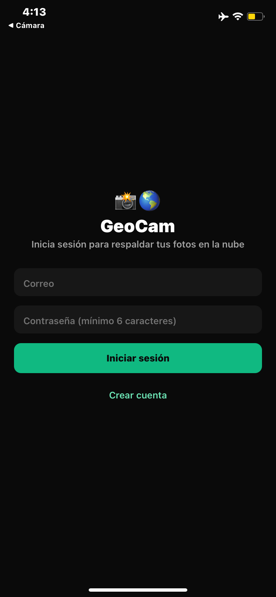 | 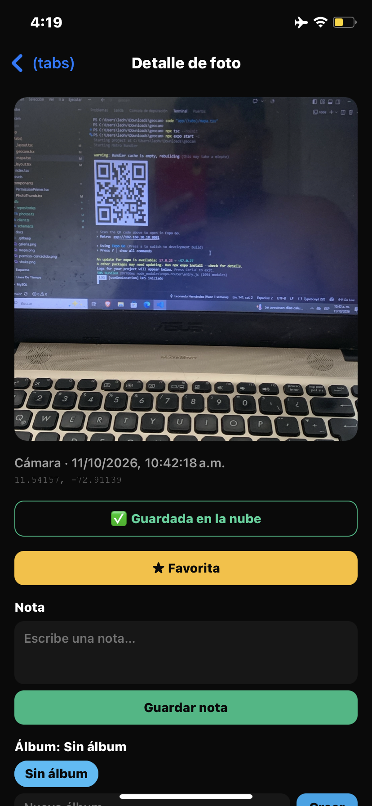 | 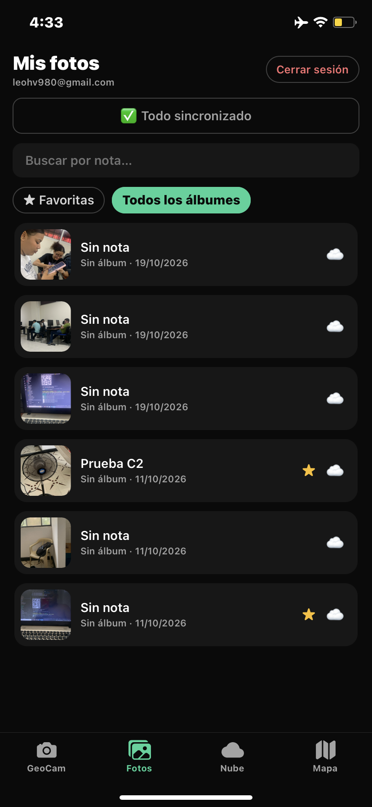 |

| T6: tabla en Supabase | T6: Storage con la carpeta del usuario | C4: pestaña Nube |
|---|---|---|
| 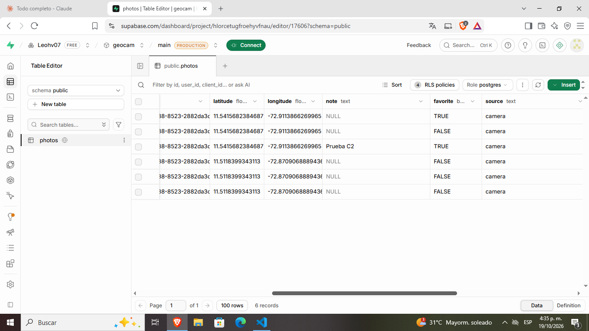 | 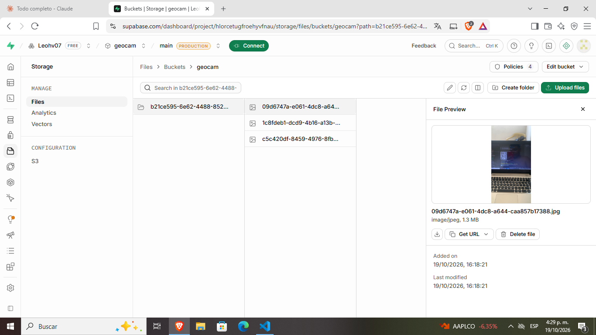 | 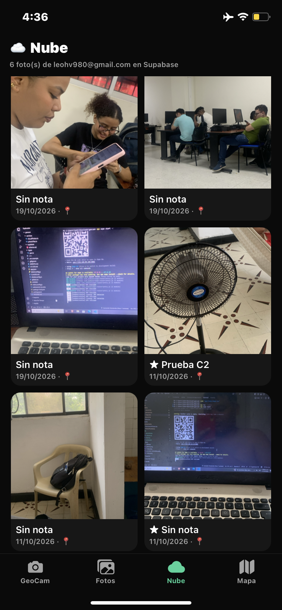 |

| C5: segunda cuenta sin fotos de la primera | C3: borrado en ambos lados |
|---|---|
| 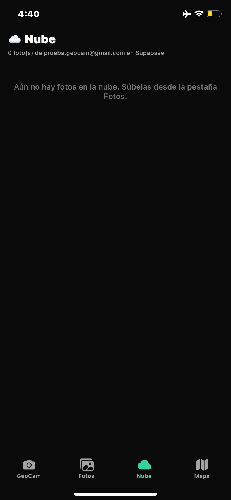 | 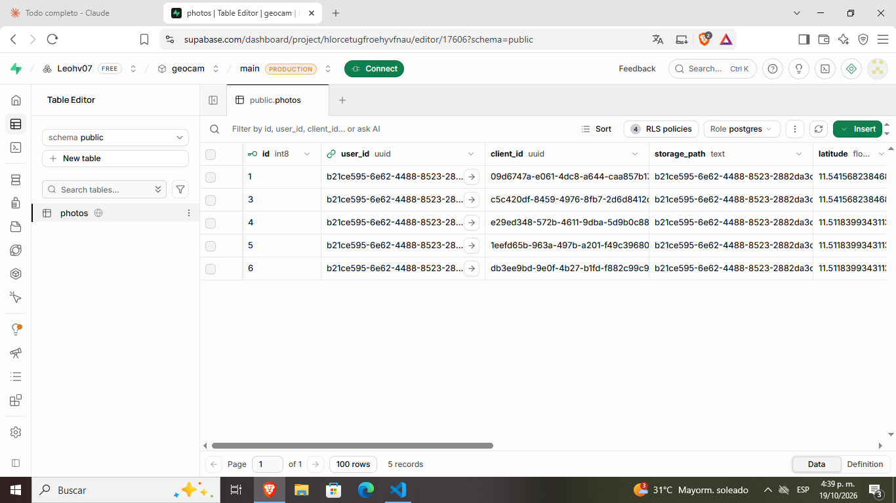 |

**GIF:** tomar foto → Sincronizar → aparece sola en la pestaña Nube.

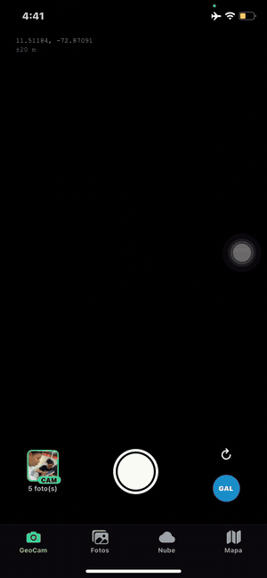

### Limitaciones
- La sincronización es **en un solo sentido** (teléfono → nube). Las fotos de otro teléfono no se descargan a SQLite; solo se ven en la pestaña Nube.
- Los álbumes siguen siendo locales y no se suben.
- Las fotos antiguas sin dueño quedan asignadas al **primer** usuario que inicia sesión en el teléfono.

---

## Semana 7 — GeoCam persistente (SQLite + Drizzle)

El `GeoPhotosContext` en memoria de la Semana 6 se reemplazó por **SQLite con Drizzle ORM**. Las fotos, sus coordenadas, notas, favoritas y álbumes sobreviven al cierre de la app, y los archivos de imagen se guardan en la carpeta de documentos. El AI-LOG de esa semana está en [`docs/AI-LOG-semana7.md`](./docs/AI-LOG-semana7.md).

### Taller en clase (T1–T6)

| Req. | Implementación |
|---|---|
| **T1** | `expo-sqlite`, `drizzle-orm`, `drizzle-kit`, `babel-plugin-inline-import`. `drizzle.config.ts` con `driver: 'expo'`. `babel.config.js` **fusionado** con los presets de NativeWind. `metro.config.js` con `sourceExts.push('sql')` dentro de `withNativeWind`. |
| **T2** | `db/client.ts`: `openDatabaseSync('geocam.db', { enableChangeListener: true })` + `PRAGMA foreign_keys = ON`. `app/_layout.tsx` muestra un loader hasta que `useMigrations` termina. |
| **T3** | `photosRepo`: `listQuery`, `withLocationQuery` (`isNotNull`), `create`, `remove`. |
| **T4** | `usePhotos`: `photos`, `photosWithLocation`, `addPhoto({ uri, coords, source })`, `removePhoto(id)`. |
| **T5** | GeoCam y Mapa usan `usePhotos`. Al agitar se llama a `clearAll`. |
| **T6** | ✅ 3 fotos → cerrar Expo Go → reabrir → **3 en el mapa**. |

| Antes de cerrar la app | Después de reabrirla |
|---|---|
| 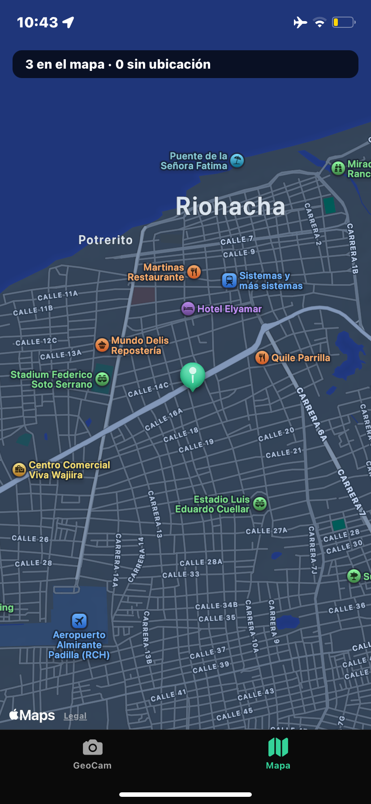 | 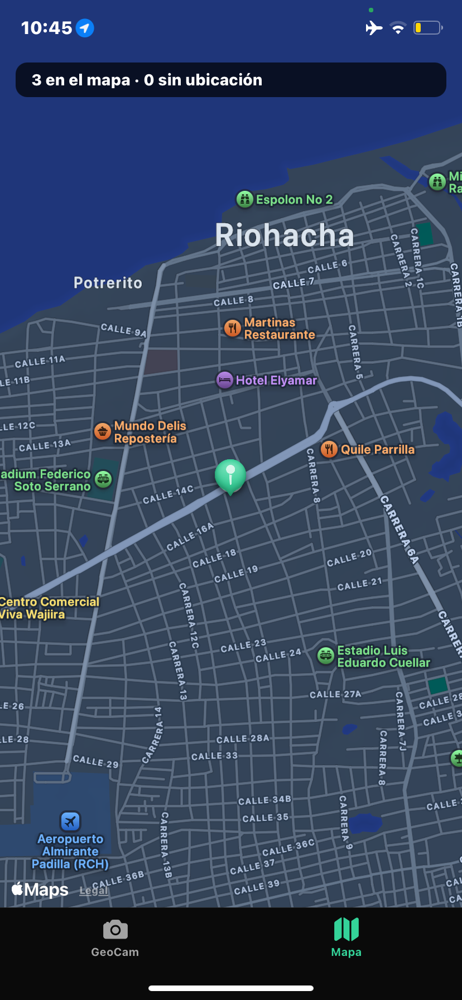 |

### Trabajo para la casa (C1–C6)

| Req. | Implementación |
|---|---|
| **C1** Álbumes | Tabla `albums` (`name` único). `photos.album_id` con `onDelete: 'set null'`, aplicado en una transacción en `albumsRepo.remove`. |
| **C2** Segunda migración | `note` y `favorite`. Probada con las 3 fotos de la clase: **siguen ahí**. |
| **C3** CRUD | `app/foto/[id].tsx`: ver, editar nota, favorita, mover de álbum, crear álbum y eliminar. |
| **C4** Búsqueda y filtros | Buscador por nota (`like`), chips de álbum y **★ Favoritas** con `useLiveQuery(consulta, deps)`. |
| **C5** Archivos permanentes | Las fotos se copian a `documents/photos/` y se borran junto con su registro. |

| C2: datos tras la 2.ª migración | C4: lista | C4: filtro ★ Favoritas |
|---|---|---|
|  | 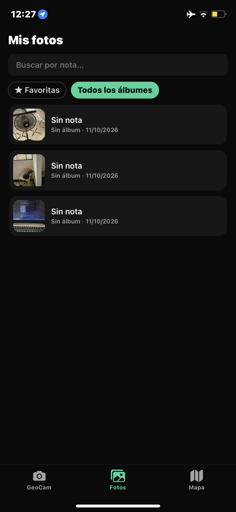 | 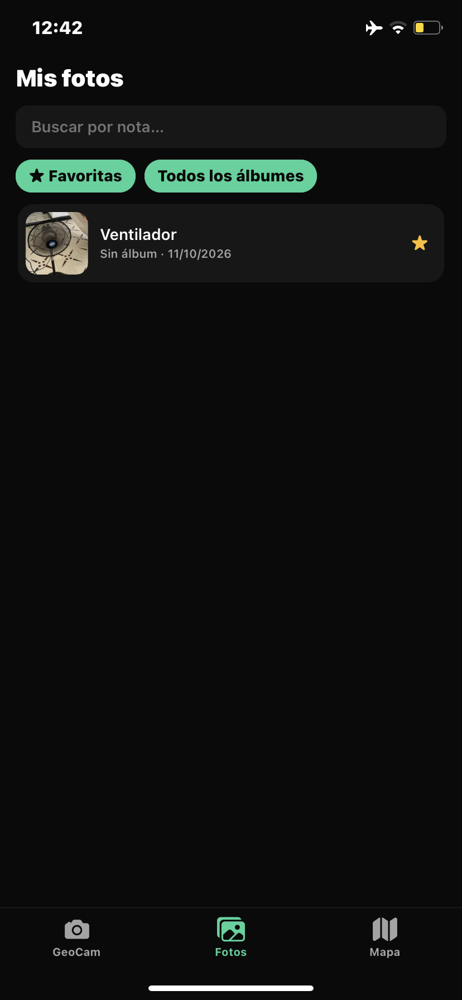 |

| C1: foto en álbum "Casa" | C1: álbum borrado, la foto sigue | C5: foto nueva guardada | C3: foto eliminada |
|---|---|---|---|
| 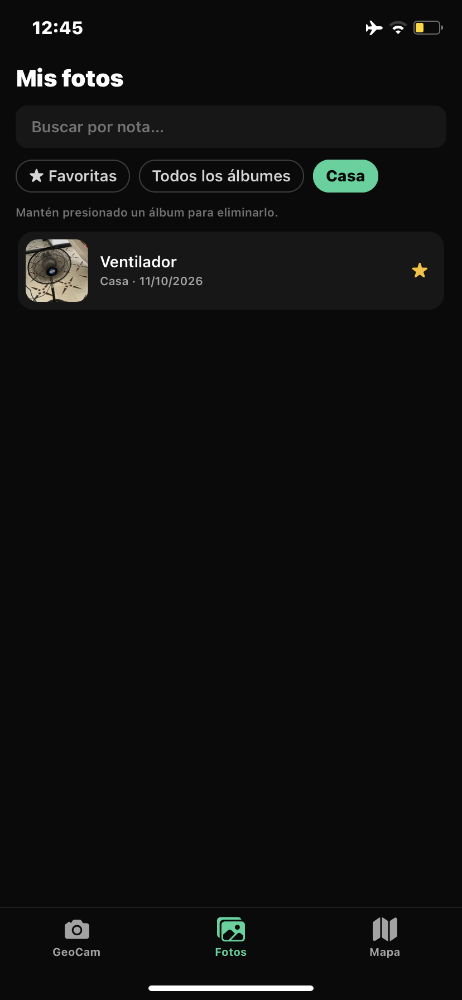 | 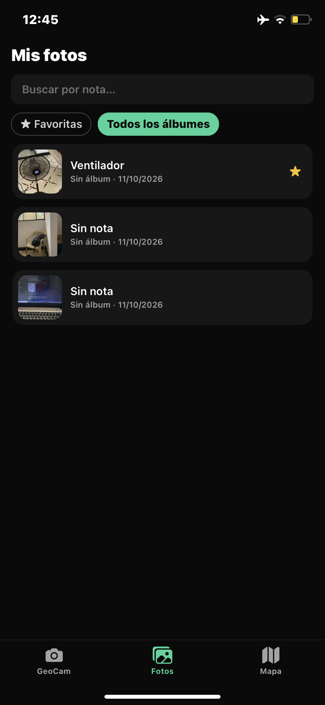 | 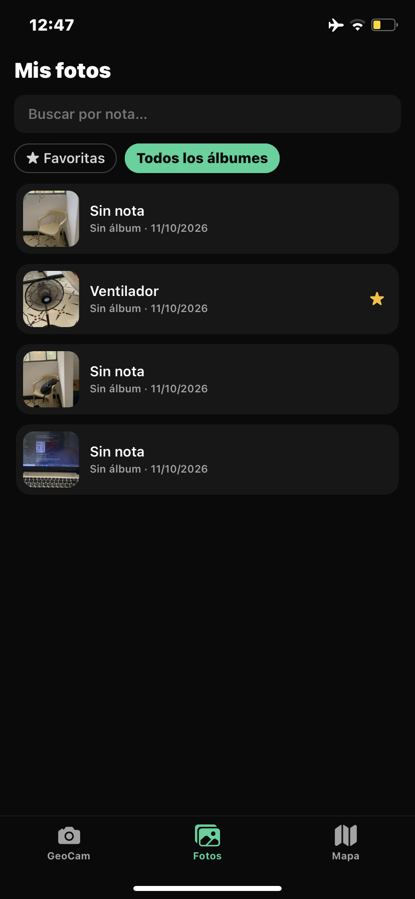 |  |

---

## Semana 6 — Sensores y permisos

El AI-LOG de esa semana está en [`docs/AI-LOG-semana6.md`](./docs/AI-LOG-semana6.md).

| Req. | Implementación |
|---|---|
| **R1** Estado global | En la Semana 6 era `GeoPhotosContext` con `useReducer`; en la Semana 7 se reemplazó por SQLite. |
| **R2** Galería | Botón **GAL** con `launchImageLibraryAsync({ mediaTypes: ['images'] })`; insignia y marker azules. |
| **R3** Mapa | Un `Marker` por foto con coordenadas; tarjeta con miniatura; lista aparte **"Sin ubicación"**. |
| **R4** `useShake` | `isAvailableAsync()` → `setUpdateInterval(100)` → umbral sobre √(x²+y²+z²) (1.8 g) → cooldown de 1500 ms → limpieza con bandera `cancelled`. |

### Retos opcionales incluidos
- **Nivel**: `useLevel` calcula la inclinación a partir de la gravedad y la línea se pone verde entre ±2°.
- **EXIF de galería**: `lib/exif.ts` normaliza el formato de iOS y el de Android.
- **Ubicación aproximada**: si `accuracy > 1000 m` se muestra un aviso naranja.

### Máquina de estados de permisos

```
checking → undetermined → (acepta) → granted
                        → (rechaza) → denied → (rechaza de nuevo) → blocked
blocked → Linking.openSettings() → (lo activa en Ajustes) → granted
```

### Capturas

| Permisos concedidos + R4 agitar | R3 Mapa | R2 Galería |
|---|---|---|
| 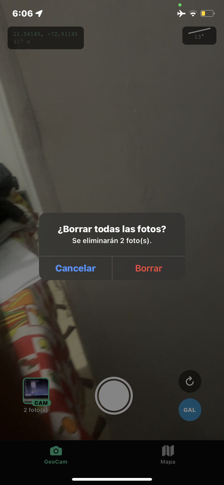 | 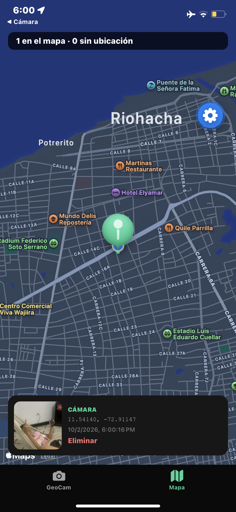 | 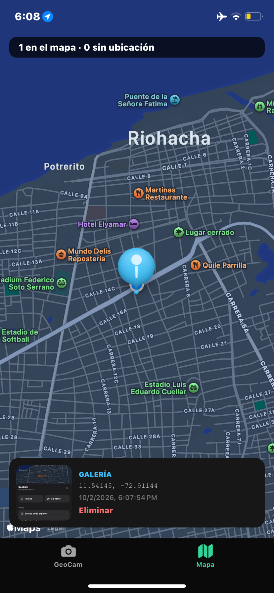 |

### Las pestañas no se desmontan
Expo Router **mantiene montadas** las pestañas. Por eso se usa `useIsFocused()`: `useGeoLocation({ watch: isFocused })`, `useShake(..., { enabled: isFocused })`, `useLevel(isFocused)`, `<CameraView active={isFocused} />` y, en la Semana 8, `useCloudPhotos(isFocused)` para cerrar el canal de Realtime al salir de la pestaña Nube.

## Limitaciones conocidas
- En **Expo Go** los textos de permisos de `app.json` no se ven; aparecen los genéricos de Expo Go.
- En **Android 10+** el sistema puede quitar la ubicación del EXIF de las fotos de galería.
- En producción Android, `react-native-maps` requiere una API key de Google Maps.