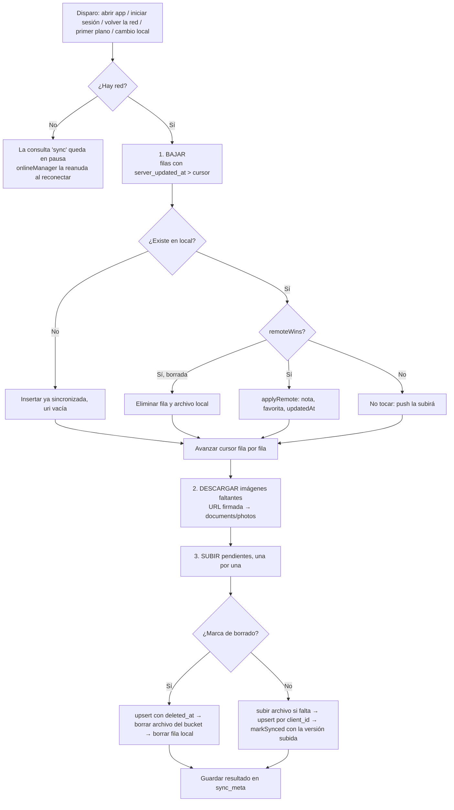
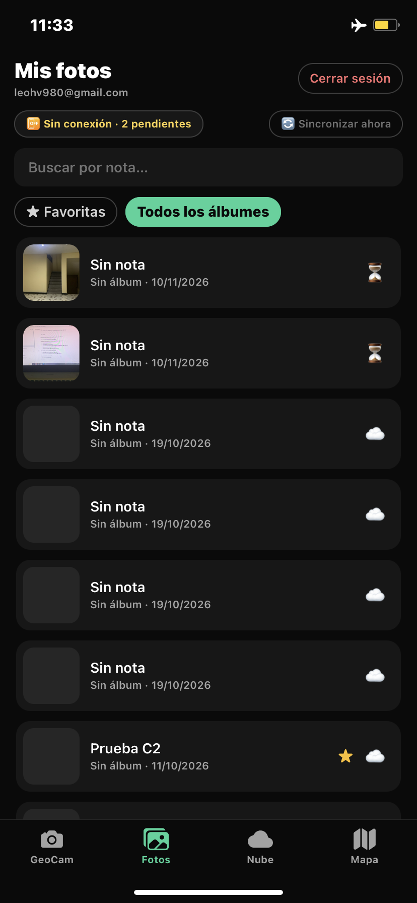
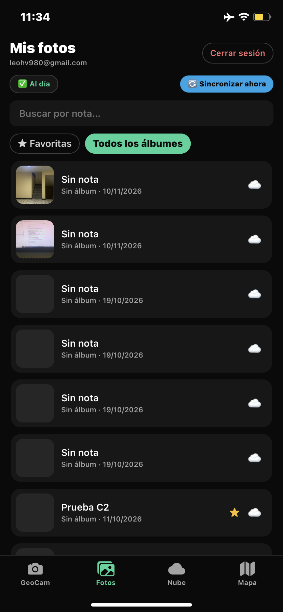
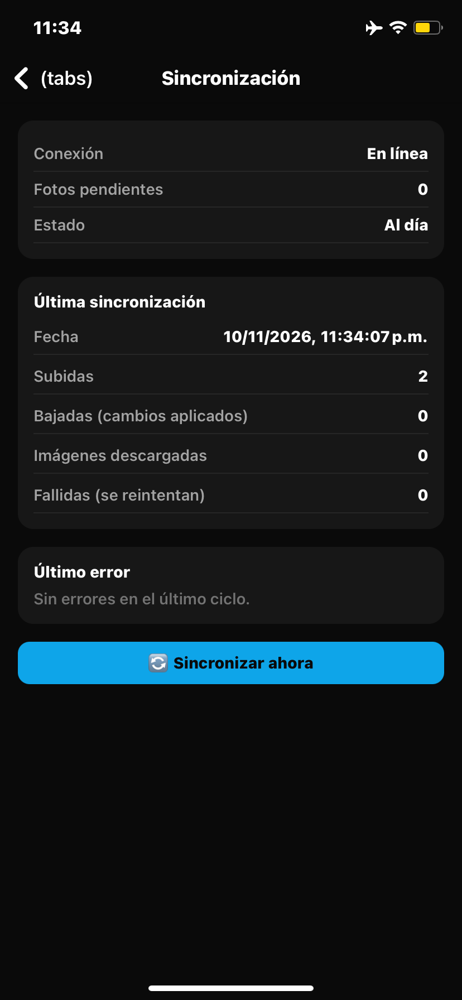
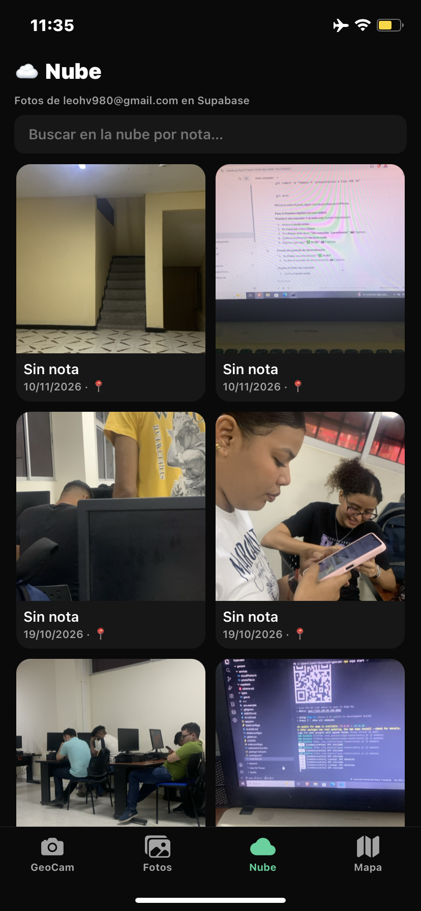
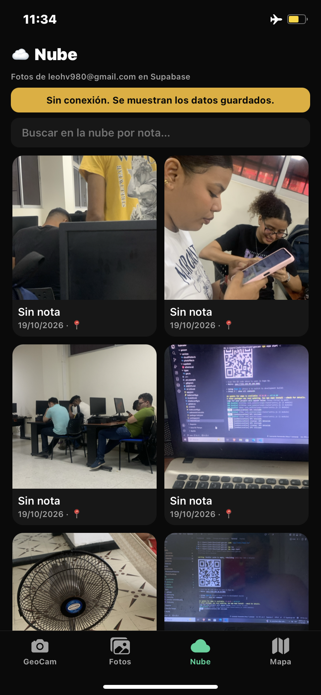
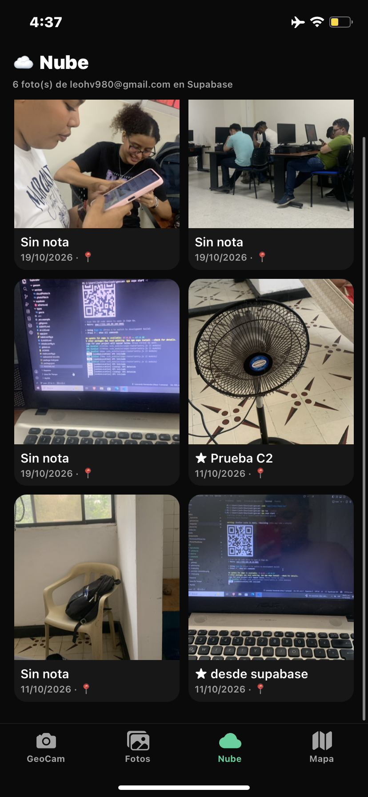
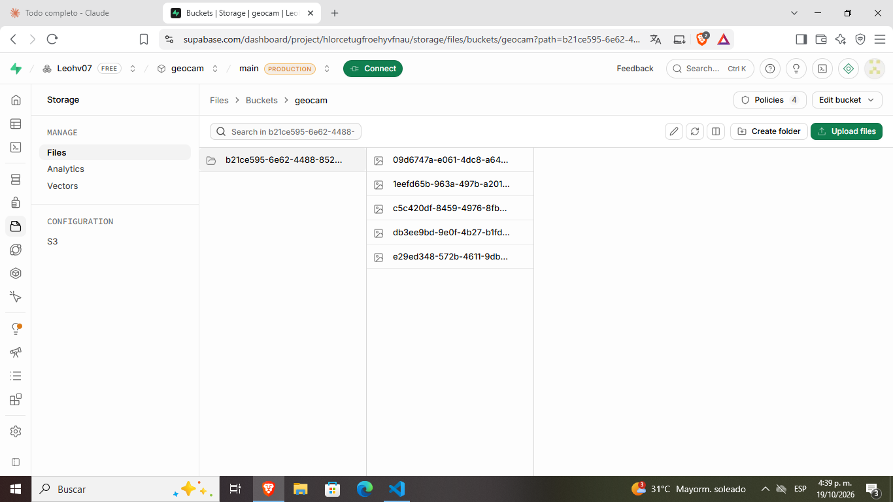

# GeoCam 📸🌎 — Semanas 6 a 9: Sensores + SQLite offline-first + Supabase + sincronización

> **Semana 9:** GeoCam ahora se **sincroniza sola en los dos sentidos** entre SQLite y Supabase con **TanStack Query**: funciona en modo avión, sube lo pendiente al volver la red, baja lo creado en otros teléfonos y resuelve conflictos con "gana el último cambio". Ver la sección [Semana 9](#semana-9--tanstack-query-y-sincronización-offline-first).
>
> **Semana 8:** cuentas de usuario y respaldo en la nube con Supabase. Ver la sección [Semana 8](#semana-8--respaldo-en-la-nube-con-supabase).


Cámara que etiqueta cada foto con coordenadas GPS, las muestra en un mapa y reacciona al movimiento del teléfono. Todo el hardware está encapsulado en **Custom Hooks tipados** (sin `any`), con permisos pedidos **en contexto** y **limpieza de todas las suscripciones**.

**Integrantes:** Leonardo Hernández, Julián Ortiz
**Curso:** Ecosistema Móvil Moderno — Taller Integrador 2

---

## Stack

| Tecnología | Versión |
|---|---|
| Expo SDK | 58 (actualizado desde 57 en la Semana 9, ver AI-LOG) |
| React Native | 0.88 (New Architecture), React 19.3 |
| Expo Router | `app/(tabs)` con 4 pestañas + `foto/[id]` + `login` |
| NativeWind | v4 (Tailwind 3) |
| Módulos nativos | `expo-camera`, `expo-location`, `expo-image-picker`, `expo-sensors`, `react-native-maps` |
| Base local (Semana 7) | `expo-sqlite` + `drizzle-orm` 0.45, migraciones con `drizzle-kit` 0.31, `expo-file-system` |
| Nube (Semana 8) | `@supabase/supabase-js` 2.x (Auth, PostgreSQL, Storage, Realtime), `expo-secure-store`, `expo-crypto` |
| Sincronización (Semana 9) | `@tanstack/react-query` 5.107, `@tanstack/react-query-persist-client` + `@tanstack/query-async-storage-persister`, `expo-network` |

> Todos los módulos se instalaron con `npx expo install`, no con `npm install`, para usar la versión compatible con el SDK.

## Cómo ejecutar

```bash
npm install
cp .env.example .env     # y completar con la URL y la publishable key de tu proyecto Supabase
npx expo start -c        # misma red Wi-Fi que el teléfono
npx expo start --tunnel  # si la red bloquea la conexión
```

1. En Supabase → **SQL Editor**, ejecuta completo [`supabase/schema.sql`](./supabase/schema.sql) y después [`supabase/semana9.sql`](./supabase/semana9.sql).
2. En **Authentication → Sign In / Providers → Email**, desactiva **Confirm email** para poder probar sin correo.
3. Escanea el QR con **Expo Go** en un **teléfono físico**: la cámara no funciona en el simulador de iOS.

> **Nota:** la versión de Expo Go del teléfono debe corresponder al SDK del proyecto (campo `expo` en `package.json`).

## Estructura

```
app/
  _layout.tsx            useMigrations → PersistQueryClientProvider → AuthProvider → Stack.Protected
  index.tsx              Redirige a /geocam o /login según la sesión
  login.tsx              Iniciar sesión / crear cuenta (Semana 8)
  sincronizacion.tsx     Estado de la sincronización + "Sincronizar ahora" (Semana 9, C4)
  (tabs)/
    _layout.tsx          Tabs GeoCam + Fotos + Nube + Mapa; mantiene activa la sincronización (S9)
    geocam.tsx           Cámara, galería (R2), agitar (R4), nivel, ubicación aproximada
    fotos.tsx            Lista con búsqueda y filtros + indicador y "Sincronizar ahora" (S9) + cerrar sesión
    nube.tsx             Feed de la nube con useInfiniteQuery, búsqueda y 4 estados de UI (S9, C2)
    mapa.tsx             Mapa con markers + lista "Sin ubicación" (R3)
  foto/[id].tsx          Detalle: nota, favorita, álbum, estado de sincronización, eliminar (borrado lógico)
components/
  PermissionPrimer.tsx   Pantalla previa de explicación / "Abrir Ajustes"
  PhotoThumb.tsx         Miniatura con insignia CAM (verde) / GAL (azul)
  SyncBadge.tsx          Indicador: sin conexión / N pendientes / sincronizando / al día (S9, T6)
context/
  AuthContext.tsx        Sesión de Supabase: session, signIn, signUp, signOut (Semana 8)
hooks/
  useGeoLocation.ts      Permiso + lectura única + seguimiento con bandera cancelled
  useCamera.ts           Permiso + captura con guarda isCapturing
  useShake.ts            Acelerómetro: umbral de magnitud + cooldown (R4)
  useLevel.ts            Indicador de nivel (reto opcional)
  useUserId.ts           id del usuario de la sesión (C5)
  usePhotos.ts           useLiveQuery + addPhoto / removePhoto / clearAll (+ requestSync)
  usePhoto.ts            Una foto + editar + borrar (borrado lógico, S9)
  useAlbums.ts           Listar, crear y borrar álbumes
  usePhotoSearch.ts      Búsqueda y filtros reactivos
  useSync.ts             Sincronización como useQuery + requestSync() + pendientes (S9, T6)
  useCloudPhotos.ts      Feed de la nube con useInfiniteQuery + Realtime que invalida la caché (S9, C2)
  useDebouncedValue.ts   Búsqueda en vivo con espera al escribir (S9)
db/
  schema.ts              Tablas albums, photos (con deletedAt) y sync_meta
  client.ts              openDatabaseSync + enableChangeListener + PRAGMA foreign_keys
  repositories/photos.ts Consultas y CRUD de fotos filtradas por dueño (única capa con Drizzle)
  repositories/albums.ts CRUD de álbumes (SET NULL en transacción)
  repositories/syncMeta.ts Cursor de bajada, último resultado y último error (S9)
drizzle/                 Migraciones 0000–0004 generadas con drizzle-kit (versionadas)
services/
  photoFiles.ts          Copiar, borrar y descargar fotos en documents/photos
  cloudPhotos.ts         Feed paginado, URL firmadas y Realtime de Supabase
  sync.ts                Ciclo bajar → descargar → subir, regla de conflicto pura (S9)
lib/
  supabase.ts            Cliente de Supabase + auto-refresh con AppState
  queryClient.ts         QueryClient + onlineManager (expo-network) + focusManager + persistencia (S9)
  secureStorage.ts       Adaptador de SecureStore por partes de 1000 caracteres
  exif.ts                Lectura de coordenadas EXIF iOS/Android (reto opcional)
supabase/
  schema.sql             Tabla, políticas RLS, Realtime y bucket (Semana 8)
  semana9.sql            server_updated_at + trigger, deleted_at e índices (Semana 9)
types/
  geo.ts                 PermissionState, Coords, PhotoSource
```

## Semana 9 — TanStack Query y sincronización offline-first

GeoCam ya no tiene botón de "subir": **SQLite es la fuente de verdad** y la app se sincroniza sola con Supabase. TanStack Query **no sincroniza bases de datos**: ejecuta, reintenta y dispara el ciclo. El diseño (qué se sube, qué se baja y quién gana) está en [`services/sync.ts`](./services/sync.ts).

### Las cinco decisiones del diseño

1. **Fuente de verdad: SQLite.** La app siempre lee y escribe en local, con o sin red. La UI nunca espera a la nube.
2. **Identidad compartida: `clientId`.** UUID creado en el teléfono. El `id` autoincremental solo vale dentro de un dispositivo.
3. **Marca de pendiente:** `syncedAt` vacío o anterior a `updatedAt` (también para las marcas de borrado).
4. **Cursor de bajada:** `lastPulledAt:<userId>` en la tabla local `sync_meta`, comparado con `server_updated_at`.
5. **Conflictos: gana el último cambio.** Queda la versión con `updated_at` más reciente: `remoteWins()` es una función pura.

### Ciclo de sincronización



**Se baja antes de subir** porque, si se subiera primero, un cambio local viejo podría pisar un cambio remoto más nuevo antes de compararlos.

### Dos relojes en la tabla remota

| Columna | Quién la escribe | Para qué sirve |
|---|---|---|
| `updated_at` | El teléfono, con la hora en que el usuario editó | Decidir quién gana un conflicto |
| `server_updated_at` | PostgreSQL, con un trigger | Cursor de bajada: "dame lo que llegó al servidor después de X" |

Una foto editada sin conexión el lunes y subida el miércoles tiene `updated_at` del lunes. Si el cursor usara esa columna, un teléfono que sincronizó el martes **nunca la bajaría**.

### La regla de conflicto con un ejemplo

Los teléfonos A y B tienen la foto `3f2a…` sincronizada con la nota "Parque". Los dos entran en modo avión.

1. **10:00** — A cambia la nota a "Parque Simón Bolívar". En A: `updatedAt = 10:00`.
2. **10:01** — B cambia la nota a "Atardecer". En B: `updatedAt = 10:01`.
3. A se reconecta primero. Baja (no hay nada nuevo) y sube su versión: la nube queda con `updated_at = 10:00`.
4. B se reconecta. **Baja primero:** la versión remota (10:00) no es más nueva que la suya (10:01), así que `remoteWins` es falso y no toca nada. Después **sube**: la nube queda con "Atardecer" y `updated_at = 10:01`.
5. A sincroniza otra vez (al volver a primer plano). Baja la fila de B: 10:01 > 10:00, así que `remoteWins` es verdadero y aplica "Atardecer".

**Resultado:** los dos teléfonos quedan con la nota de B, el último cambio. La edición de A se pierde. Es aceptable para notas personales; no lo sería para un saldo bancario. Además depende de que la hora de los teléfonos sea razonable.

### Por qué es seguro reintentar (idempotencia)

- El archivo siempre va a la misma ruta `<userId>/<clientId>.jpg`, con `upsert: true`.
- La fila se sube con `upsert(..., { onConflict: 'client_id' })`: crea o actualiza, nunca duplica.
- `markSynced` guarda `syncedAt = updatedAt` **de la versión subida**, no "ahora". Si el usuario edita durante la subida, la foto sigue pendiente.
- `syncAll` reutiliza el ciclo en curso: si llegan dos disparos a la vez, se hace uno solo.

### Taller en clase (T1–T7)

| Tarea | Dónde |
|---|---|
| T1. Backend: `server_updated_at` + trigger + índice | [`supabase/semana9.sql`](./supabase/semana9.sql). La política de `update` ya existía desde la Semana 8 ("actualizar las mías"). |
| T2. TanStack Query + `onlineManager` (expo-network) + `focusManager` | [`lib/queryClient.ts`](./lib/queryClient.ts), proveedor en [`app/_layout.tsx`](./app/_layout.tsx) |
| T3. `sync_meta` + `pendingQuery`, `listPending`, `findByClientId`, `insertFromRemote`, `applyRemote`, `markSynced` | Migración `drizzle/0004_semana9_sync.sql`, [`db/repositories/photos.ts`](./db/repositories/photos.ts), [`db/repositories/syncMeta.ts`](./db/repositories/syncMeta.ts) |
| T4. `pull(userId)` con cursor y "gana el último cambio" | [`services/sync.ts`](./services/sync.ts) |
| T5. `push(userId)`: archivo si falta + upsert por `client_id` + `markSynced` | [`services/sync.ts`](./services/sync.ts) |
| T6. `useSync` con `useQuery`, `requestSync()` tras cada cambio, indicador | [`hooks/useSync.ts`](./hooks/useSync.ts), [`components/SyncBadge.tsx`](./components/SyncBadge.tsx) |
| T7. Pruebas sin conexión, dos teléfonos y conflicto | Matriz de pruebas (abajo), escenarios 1, 2 y 3 |

Se conserva lo de la Semana 8: login, `Stack.Protected`, `ownerId` por usuario (C5: `insertFromRemote` guarda el dueño y `listPending` filtra por él), subida sin duplicados ni archivos huérfanos (C2) y la pestaña Nube.

### Trabajo para la casa (C1–C7)

- **C1. Borrados sincronizados.** Borrar una foto es marcarla: se ponen `deletedAt` y `updatedAt` con la hora actual, y la UI la oculta. Funciona sin conexión. `push` sube la marca (`deleted_at`) y, ya sincronizada, borra el archivo del bucket y la fila y el archivo locales. Los demás teléfonos aplican la marca al bajar. Si una edición local es posterior a un borrado remoto, gana la edición y la foto se vuelve a subir con su archivo.
- **C2. Feed de la nube.** La pestaña Nube usa `useInfiniteQuery`, con paginación por cursor (`taken_at < último`), infinite scroll, búsqueda en vivo por nota (400 ms de espera) y los cuatro estados de UI: carga, error con reintento, vacío y sin conexión. Realtime solo invalida la caché.
- **C3. Caché que sobrevive al cierre.** `PersistQueryClientProvider` guarda la caché en el `kv-store` de `expo-sqlite`. Solo se persisten las consultas `['cloud', userId, …]`; la sincronización nunca. Al cerrar sesión se limpia la caché.
- **C4. Pantalla de estado.** [`app/sincronizacion.tsx`](./app/sincronizacion.tsx) muestra las pendientes, la fecha de la última sincronización, cuántas subieron, bajaron, se descargaron y fallaron, el último error y "Sincronizar ahora". Se abre al tocar el indicador.
- **C5. Errores por foto.** Cada foto se sube en su propio `try/catch`: si una falla, las demás continúan y ella queda pendiente para el siguiente ciclo. Lo mismo pasa con las descargas: una foto bajada sin imagen queda con `uri` vacía (se ve ⬇️) y se reintenta en cada ciclo sin romper la sincronización.
- **C6. Matriz de pruebas** (abajo).
- **C7. Documentación:** esta sección, las capturas y [`AI-LOG.md`](./AI-LOG.md).

### C6 — Matriz de pruebas

> Probado en: **un solo iPhone con Expo Go SDK 58**, cuenta `leohv980@gmail.com`. Fecha: 10/11/2026. Los escenarios que necesitan un segundo teléfono no se alcanzaron a ejecutar y se dejan marcados como pendientes.

| # | Escenario | Resultado esperado | Resultado obtenido |
|---|---|---|---|
| 1 | Foto tomada sin conexión; luego se reconecta | Se sube sola; pendientes vuelve a 0 | ✅ En modo avión: "Sin conexión · 2 pendientes" (⏳). Al quitar el modo avión, sin tocar nada, pasó a "✅ Al día". Pantalla de estado: 2 subidas, 0 fallidas |
| 2 | Foto creada en el teléfono A | Aparece en B con imagen y ubicación | ⏳ No probado: requiere un segundo teléfono |
| 3 | Nota editada en A y después en B, ambos sin conexión | En los dos queda la nota de B | ⏳ No probado: requiere un segundo teléfono |
| 4 | Foto borrada en A | Desaparece en B y del bucket | ⏳ No probado en esta entrega |
| 5 | Foto editada en A y borrada después en B, ambos sin conexión | Queda borrada en los dos (el borrado es el último cambio) | ⏳ No probado: requiere un segundo teléfono |
| 6 | Se corta la red a mitad de una sincronización de 5 fotos | Al reconectar termina sin duplicar filas ni archivos | ⏳ No probado en esta entrega |
| 7 | Se cierra la app con fotos pendientes y se abre con red | Se sincroniza al abrir | ⏳ No probado en esta entrega |
| 8 | Pestaña Nube sin conexión (C3) | Aviso "Sin conexión" y la lista guardada | ✅ "Sin conexión. Se muestran los datos guardados." con las fotos en caché |
| 9 | Pantalla de sincronización (C4) | Pendientes, última sincronización, error y botón | ✅ En línea, 0 pendientes, 2 subidas, 0 bajadas, 0 fallidas, "Sin errores en el último ciclo" |
| 10 | Migración 0004 sobre los datos de la Semana 8 | No se pierde ninguna foto | ✅ Las 6 fotos y la nota "Prueba C2" siguieron en el teléfono |

### Capturas

| | |
|---|---|
| Indicador con pendientes en modo avión |  |
| Indicador "Al día" tras reconectar |  |
| Pantalla de sincronización (C4) |  |
| Pestaña Nube: feed y búsqueda (C2) |  |
| Pestaña Nube sin conexión con caché (C3) |  |

### Preguntas para sustentar

1. **¿Por qué se baja antes de subir?** Para comparar antes de escribir: si se subiera primero, una versión local vieja pisaría en la nube una versión más nueva de otro teléfono.
2. **¿Para qué dos fechas?** `updated_at` (teléfono) decide conflictos; `server_updated_at` (servidor) es el cursor. Con una sola, un cambio hecho sin conexión y subido tarde quedaría "antes" del cursor de otros teléfonos y nunca se bajaría.
3. **¿Qué es idempotente?** Que repetir la subida da el mismo resultado: `upsert` por `client_id` y ruta fija del archivo. Por eso TanStack Query puede reintentar sin duplicar.
4. **¿Por qué no un DELETE directo?** Porque una fila borrada no deja rastro: los demás teléfonos nunca se enteran. La marca `deleted_at` sí llega con el cursor.
5. **¿Qué hace TanStack Query y qué es diseño propio?** TanStack Query decide **cuándo** ejecutar (al montar, al reconectar, al volver al primer plano, al invalidar), pausa sin red y reintenta. Qué se sube, qué se baja, el orden y quién gana es diseño propio en `services/sync.ts`.

### Limitaciones

- **Miniaturas de fotos anteriores a SDK 58:** al actualizarse Expo Go a SDK 58, iOS cambió la carpeta interna de la app. SQLite guarda la ruta completa de cada foto, así que las fotos tomadas antes de la actualización salen con la miniatura vacía en Fotos y en el detalle (siguen bien en la pestaña Nube, que usa URL firmadas). Las fotos nuevas se ven bien. Arreglo pendiente: guardar solo el nombre del archivo y, si no existe, volver a descargarlo con `remotePath`.
- Los **álbumes no se sincronizan**: son locales a cada teléfono. Una foto bajada llega sin álbum.
- "Gana el último cambio" depende de que la hora de los teléfonos sea razonable.
- `pull` trae páginas de 200 filas hasta terminar. Una fila que falle al aplicarse detiene la bajada en ese punto y el siguiente ciclo continúa desde ahí.
- La caché persistida de la Nube guarda URL firmadas de 1 hora: sin conexión se ve la lista, pero las imágenes solo aparecen si iOS las tiene en caché. Las fotos propias siempre se ven sin conexión en Fotos y Mapa, porque están en `documents/photos`.

## Semana 8 — Respaldo en la nube con Supabase

El teléfono sigue siendo la **fuente principal** (offline-first): la foto se guarda en SQLite al tomarla y se sube a Supabase cuando el usuario lo pide, una por una o con **Sincronizar**.

### Arquitectura: dos bases de datos

```
                 📱 iPhone (offline-first)                                ☁️ Supabase
┌──────────────────────────────────────────────┐          ┌─────────────────────────────────────────┐
│ Pantallas  geocam · fotos · nube · mapa ·    │          │ Auth        correo + contraseña         │
│            foto/[id] · login                 │          │             (sesión → SecureStore)      │
│    ↓ usan                                    │          │                                         │
│ Hooks      usePhotos · usePhoto · useSync ·  │          │ PostgreSQL  public.photos  (RLS)        │
│            useCloudPhotos · useUserId        │          │   user_id = auth.uid()                  │
│    ↓ llaman                                  │  subir   │   client_id UNIQUE ◄────────────┐       │
│ photosRepo (Drizzle) │ cloudPhotos (Supabase)├─────────►│   storage_path UNIQUE           │       │
│    ↓                 │                       │  borrar  │                                 │ mismo │
│ SQLite  geocam.db    │                       │          │ Storage     bucket privado      │ UUID  │
│   photos.client_id ──┼───────────────────────┼──────────┼───► geocam/<user_id>/<client_id>.jpg   │
│   photos.owner_id    │                       │ Realtime │                                         │
│   synced_at / updated_at                     │◄─────────┤ supabase_realtime → pestaña Nube        │
│ documents/photos/*.jpg                       │          │                                         │
└──────────────────────────────────────────────┘          └─────────────────────────────────────────┘
```

- **`client_id`** es un UUID creado en el teléfono. Identifica la misma foto en SQLite, en PostgreSQL y en la ruta del archivo, y por eso no se duplica.
- **Pendiente** = `synced_at IS NULL OR synced_at < updated_at`. Cada edición escribe `updated_at`; subir solo escribe `synced_at`.
- Las pantallas no importan Drizzle ni Supabase: todo pasa por hooks, `db/repositories` y `services/cloudPhotos.ts`.

### Tablas

```
SQLite (teléfono) — photos                    PostgreSQL (Supabase) — public.photos
┌───────────────────────────────────┐          ┌──────────────────────────────────────────┐
│ id          integer PK            │          │ id           bigint identity PK          │
│ uri         text                  │          │ user_id      uuid → auth.users (cascade) │
│ latitude / longitude / accuracy   │  ─────►  │ latitude / longitude                     │
│ source      camera | gallery      │  ─────►  │ source       check camera | gallery      │
│ created_at  integer (ms)          │  ─────►  │ taken_at     timestamptz                 │
│ album_id    FK albums (null)      │          │                                          │
│ note / favorite                   │  ─────►  │ note / favorite                          │
│ client_id   text UNIQUE      (T4) │  ═════►  │ client_id    uuid UNIQUE                 │
│ updated_at  integer          (T4) │  ─────►  │ updated_at   timestamptz                 │
│ remote_path text             (T4) │  ═════►  │ storage_path text UNIQUE                 │
│ synced_at   integer          (T4) │          │ created_at   timestamptz default now()   │
│ owner_id    text             (C5) │          └──────────────────────────────────────────┘
└───────────────────────────────────┘
```

### SQL completo de Supabase ([`supabase/schema.sql`](./supabase/schema.sql))

```sql
create table public.photos (
  id bigint generated always as identity primary key,
  user_id uuid not null default auth.uid() references auth.users (id) on delete cascade,
  client_id uuid not null unique,
  storage_path text not null unique,
  latitude double precision,
  longitude double precision,
  note text,
  favorite boolean not null default false,
  source text not null check (source in ('camera', 'gallery')),
  taken_at timestamptz not null,
  updated_at timestamptz not null,
  created_at timestamptz not null default now()
);

alter table public.photos enable row level security;

create policy "ver las mías" on public.photos
  for select to authenticated using ((select auth.uid()) = user_id);
create policy "crear las mías" on public.photos
  for insert to authenticated with check ((select auth.uid()) = user_id);
create policy "actualizar las mías" on public.photos
  for update to authenticated
  using ((select auth.uid()) = user_id) with check ((select auth.uid()) = user_id);
create policy "borrar las mías" on public.photos
  for delete to authenticated using ((select auth.uid()) = user_id);

alter publication supabase_realtime add table public.photos;

insert into storage.buckets (id, name, public) values ('geocam', 'geocam', false);

create policy "subir a mi carpeta" on storage.objects
  for insert to authenticated
  with check (bucket_id = 'geocam' and (storage.foldername(name))[1] = (select auth.uid()::text));
create policy "leer mi carpeta" on storage.objects
  for select to authenticated
  using (bucket_id = 'geocam' and (storage.foldername(name))[1] = (select auth.uid()::text));
create policy "reemplazar en mi carpeta" on storage.objects
  for update to authenticated
  using (bucket_id = 'geocam' and (storage.foldername(name))[1] = (select auth.uid()::text))
  with check (bucket_id = 'geocam' and (storage.foldername(name))[1] = (select auth.uid()::text));
create policy "borrar de mi carpeta" on storage.objects
  for delete to authenticated
  using (bucket_id = 'geocam' and (storage.foldername(name))[1] = (select auth.uid()::text));
```

### Migraciones locales (generadas con `npm run db:generate`, ninguna editada a mano)

| Archivo | Contenido |
|---|---|
| `drizzle/0000_init_photos.sql` | `CREATE TABLE photos` (Semana 7) |
| `drizzle/0001_albums_note_favorite.sql` | Tabla `albums` + `album_id`, `note`, `favorite` (Semana 7) |
| `drizzle/0002_sync_fields.sql` | `client_id` (índice único), `updated_at`, `remote_path`, `synced_at` (T4) |
| `drizzle/0003_owner_id.sql` | `owner_id` (C5) |

Las fotos anteriores reciben `client_id` y `owner_id` en `photosRepo.ensureSyncFields()` al iniciar sesión, así que **no se pierde ninguna**: las 3 fotos de la Semana 7 aparecieron en la cuenta nueva y se subieron a la nube.

### Taller en clase (T1–T6)

| Req. | Implementación |
|---|---|
| **T1** | Proyecto Supabase + `@supabase/supabase-js`, `expo-secure-store`, `expo-crypto`. `.env` con `EXPO_PUBLIC_SUPABASE_URL` y `EXPO_PUBLIC_SUPABASE_KEY` (publishable). `.env` en `.gitignore`, `.env.example` versionado. |
| **T2** | `lib/supabase.ts` (sesión en SecureStore, `detectSessionInUrl: false`, auto-refresh con `AppState`), `context/AuthContext.tsx`, `app/login.tsx` y `Stack.Protected` en `app/_layout.tsx`. ✅ La sesión sobrevive al cierre de Expo Go. |
| **T3** | `supabase/schema.sql`: tabla `photos` con RLS en las 4 operaciones y bucket **privado** `geocam` con una carpeta por usuario. |
| **T4** | Migración `0002_sync_fields`: `clientId`, `updatedAt`, `remotePath`, `syncedAt`. `update()` siempre escribe `updatedAt`; `markSynced()` no lo toca. |
| **T5** | Botón **☁️ Subir a la nube** en `foto/[id]`: `uploadPhoto()` sube el archivo como `ArrayBuffer` a `<user_id>/<client_id>.jpg` y crea la fila. |
| **T6** | ✅ La foto aparece en **Table Editor** y en **Storage** dentro de la carpeta del usuario (image/jpeg, 1.3 MB). |

### Trabajo para la casa (C1–C7)

| Req. | Implementación | Archivos |
|---|---|---|
| **C1** Sincronizar | Botón en **Fotos** con el número de pendientes, avance "Subiendo 1 de 1…" y resumen "Subidas X de Y". Si una foto falla, las demás continúan. | `hooks/useSync.ts`, `services/cloudPhotos.ts` (`syncPending`) |
| **C2** Sin duplicados ni huérfanos | Mismo `client_id` → misma ruta. Si la fila ya existe, solo se actualizan los metadatos (botón "Actualizar en la nube"). Si la fila falla después de subir el archivo, el archivo se borra. ✅ Al editar la nota y re-sincronizar siguieron 6 filas. | `services/cloudPhotos.ts` (`uploadPhoto`) |
| **C3** Borrado coherente | Primero se borran la fila remota y el archivo del bucket, después la foto local. Sin conexión: "No se borró nada". ✅ De 6 a 5 filas y de 6 a 5 archivos. | `deleteRemotePhoto`, `hooks/usePhotos.ts`, `hooks/usePhoto.ts` |
| **C4** Pestaña Nube | Lista de `public.photos` con URL firmadas (1 h) y canal Realtime filtrado por `user_id`, limpiado con `removeChannel`. ✅ Una nota editada en Supabase apareció sola en el iPhone. | `app/(tabs)/nube.tsx`, `hooks/useCloudPhotos.ts` |
| **C5** Fotos por usuario | RLS en PostgreSQL y Storage + `owner_id` en SQLite: cada consulta local filtra por el usuario de la sesión. ✅ Una segunda cuenta ve 0 fotos. | `drizzle/0003_owner_id.sql`, `hooks/useUserId.ts`, `db/repositories/photos.ts` |
| **C6** Auditoría de secretos | Ver la sección siguiente. | `.gitignore`, `.env.example` |
| **C7** Documentación | Este README + `AI-LOG.md` + GIF. | — |

### C6 — Auditoría de secretos

| Comprobación | Resultado |
|---|---|
| `git log --all --full-history -- .env` | Sin resultados: `.env` nunca se subió |
| `git ls-files .env` | Sin resultados: `.env` no está versionado |
| `.env.example` en el repositorio | ✅ Solo con valores de ejemplo |
| Búsqueda de claves secretas con `git grep` | Solo aparece esta tabla del README |
| Clave usada en la app | Solo la **publishable key**, que es pública y está protegida por RLS |
| Contraseña de la base de datos | No se usa en la app; se restableció después de compartirla por error |

### Capturas (iPhone, Expo Go SDK 57)

| T2: login | T5: subir a la nube | C1: todo sincronizado |
|---|---|---|
|  |  |  |

| C4: pestaña Nube | C4: tiempo real ("desde supabase") | C5: segunda cuenta sin fotos |
|---|---|---|
|  |  |  |

**T6 + C2:** la fila en `public.photos` con la nota "Prueba C2" actualizada, sin duplicados (6 filas):


**T6:** el archivo en Storage dentro de la carpeta del usuario (`geocam/<user_id>/<client_id>.jpg`, 1.3 MB):


**C3:** después de eliminar una foto, quedan 5 filas y 5 archivos:

| Tabla | Storage |
|---|---|
|  |  |

**GIF (C7):** tomar foto → Sincronizar ("Subidas: 1 de 1") → aparece en la pestaña Nube.


### Verificación final
- [x] `npx tsc --noEmit` sin errores.
- [x] Registro, login, sesión persistente y cierre de sesión.
- [x] La foto aparece en la tabla y en Storage dentro de la carpeta del usuario, y no pesa 0 bytes.
- [x] Sincronizar sube las pendientes con avance y resumen.
- [x] Re-sincronizar no duplica filas ni archivos.
- [x] Eliminar borra la fila y el archivo en la nube y en el teléfono.
- [x] La pestaña Nube se actualiza en tiempo real.
- [x] Una segunda cuenta no ve las fotos de la primera.
- [x] `.env` nunca se subió al repositorio.

### Limitaciones
- La sincronización es **en un solo sentido** (teléfono → nube). Las fotos de otro teléfono no se descargan a SQLite, y una nota editada en Supabase solo se ve en la pestaña Nube.
- Los álbumes siguen siendo locales y no se suben.
- Las fotos antiguas sin dueño quedan asignadas al **primer** usuario que inicia sesión en el teléfono.

---

## Semana 7 — GeoCam persistente (SQLite + Drizzle)

El `GeoPhotosContext` en memoria de la Semana 6 se reemplazó por **SQLite con Drizzle ORM**. Las fotos, sus coordenadas, notas, favoritas y álbumes sobreviven al cierre de la app, y los archivos de imagen se guardan en la carpeta de documentos. El AI-LOG de esa semana está en [`docs/AI-LOG-semana7.md`](./docs/AI-LOG-semana7.md).

### Taller en clase (T1–T6)

| Req. | Implementación |
|---|---|
| **T1** | `expo-sqlite`, `drizzle-orm`, `drizzle-kit`, `babel-plugin-inline-import`. `drizzle.config.ts` con `driver: 'expo'`. `babel.config.js` **fusionado** con los presets de NativeWind. `metro.config.js` con `sourceExts.push('sql')` dentro de `withNativeWind`. |
| **T2** | `db/client.ts`: `openDatabaseSync('geocam.db', { enableChangeListener: true })` + `PRAGMA foreign_keys = ON`. `app/_layout.tsx` muestra un loader hasta que `useMigrations` termina. |
| **T3** | `photosRepo`: `listQuery`, `withLocationQuery` (`isNotNull`), `create`, `remove`. |
| **T4** | `usePhotos`: `photos`, `photosWithLocation`, `addPhoto({ uri, coords, source })`, `removePhoto(id)`. |
| **T5** | GeoCam y Mapa usan `usePhotos`. Al agitar se llama a `clearAll`. |
| **T6** | ✅ 3 fotos → cerrar Expo Go → reabrir → **3 en el mapa**. |

| Antes de cerrar la app | Después de reabrirla |
|---|---|
|  |  |

### Trabajo para la casa (C1–C6)

| Req. | Implementación |
|---|---|
| **C1** Álbumes | Tabla `albums` (`name` único). `photos.album_id` con `onDelete: 'set null'`, aplicado en una transacción en `albumsRepo.remove`. |
| **C2** Segunda migración | `note` y `favorite`. Probada con las 3 fotos de la clase: **siguen ahí**. |
| **C3** CRUD | `app/foto/[id].tsx`: ver, editar nota, favorita, mover de álbum, crear álbum y eliminar. |
| **C4** Búsqueda y filtros | Buscador por nota (`like`), chips de álbum y **★ Favoritas** con `useLiveQuery(consulta, deps)`. |
| **C5** Archivos permanentes | Las fotos se copian a `documents/photos/` y se borran junto con su registro. |

| C2: datos tras la 2.ª migración | C4: lista | C4: filtro ★ Favoritas |
|---|---|---|
|  |  |  |

| C1: foto en álbum "Casa" | C1: álbum borrado, la foto sigue | C5: foto nueva guardada | C3: foto eliminada |
|---|---|---|---|
|  |  |  |  |

---

## Semana 6 — Sensores y permisos

El AI-LOG de esa semana está en [`docs/AI-LOG-semana6.md`](./docs/AI-LOG-semana6.md).

| Req. | Implementación |
|---|---|
| **R1** Estado global | En la Semana 6 era `GeoPhotosContext` con `useReducer`; en la Semana 7 se reemplazó por SQLite. |
| **R2** Galería | Botón **GAL** con `launchImageLibraryAsync({ mediaTypes: ['images'] })`; insignia y marker azules. |
| **R3** Mapa | Un `Marker` por foto con coordenadas; tarjeta con miniatura; lista aparte **"Sin ubicación"**. |
| **R4** `useShake` | `isAvailableAsync()` → `setUpdateInterval(100)` → umbral sobre √(x²+y²+z²) (1.8 g) → cooldown de 1500 ms → limpieza con bandera `cancelled`. |

### Retos opcionales incluidos
- **Nivel**: `useLevel` calcula la inclinación a partir de la gravedad y la línea se pone verde entre ±2°.
- **EXIF de galería**: `lib/exif.ts` normaliza el formato de iOS y el de Android.
- **Ubicación aproximada**: si `accuracy > 1000 m` se muestra un aviso naranja.

### Máquina de estados de permisos

```
checking → undetermined → (acepta) → granted
                        → (rechaza) → denied → (rechaza de nuevo) → blocked
blocked → Linking.openSettings() → (lo activa en Ajustes) → granted
```

### Capturas

| Permisos concedidos + R4 agitar | R3 Mapa | R2 Galería |
|---|---|---|
|  |  |  |

### Las pestañas no se desmontan
Expo Router **mantiene montadas** las pestañas. Por eso se usa `useIsFocused()`: `useGeoLocation({ watch: isFocused })`, `useShake(..., { enabled: isFocused })`, `useLevel(isFocused)`, `<CameraView active={isFocused} />` y, en la Semana 8, `useCloudPhotos(isFocused)` para cerrar el canal de Realtime al salir de la pestaña Nube.

## Limitaciones conocidas
- En **Expo Go** los textos de permisos de `app.json` no se ven; aparecen los genéricos de Expo Go.
- En **Android 10+** el sistema puede quitar la ubicación del EXIF de las fotos de galería.
- En producción Android, `react-native-maps` requiere una API key de Google Maps.