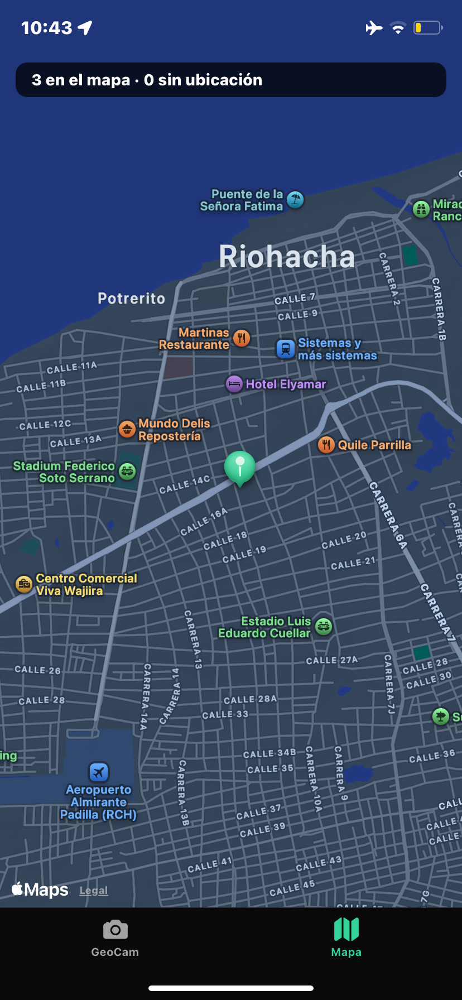
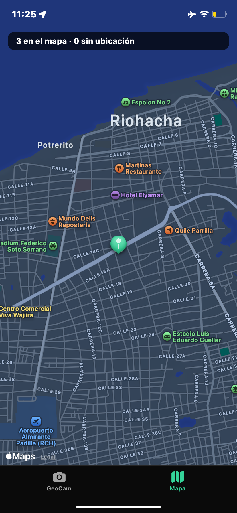
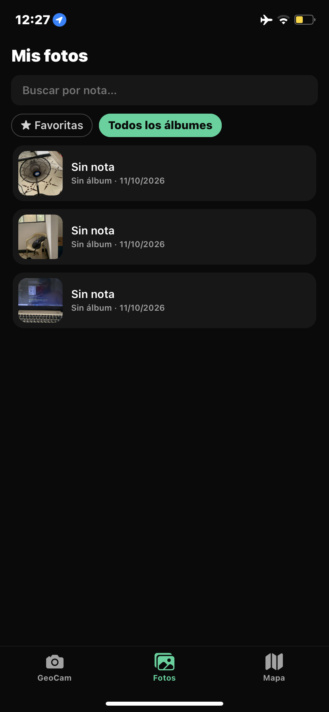
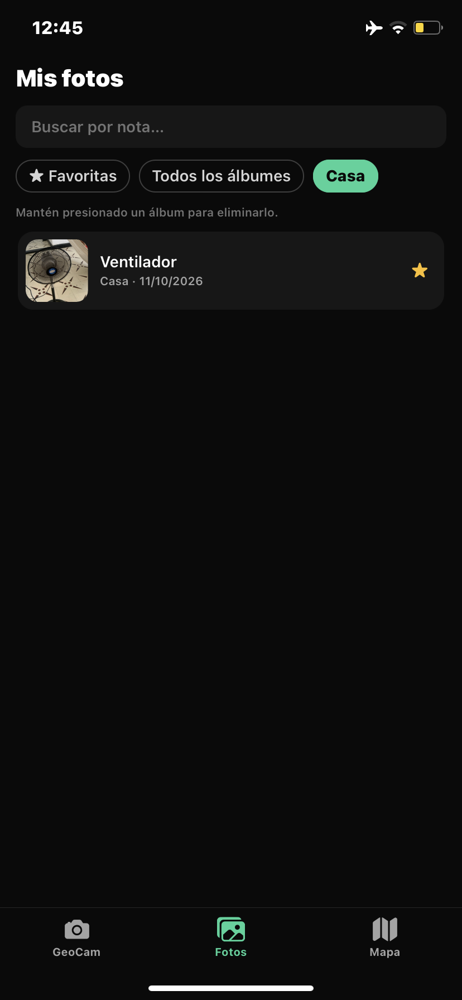
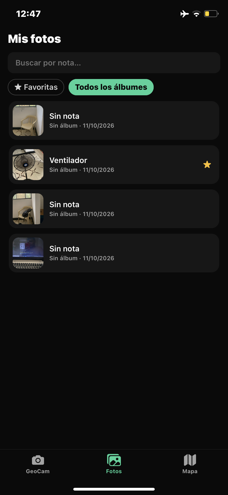
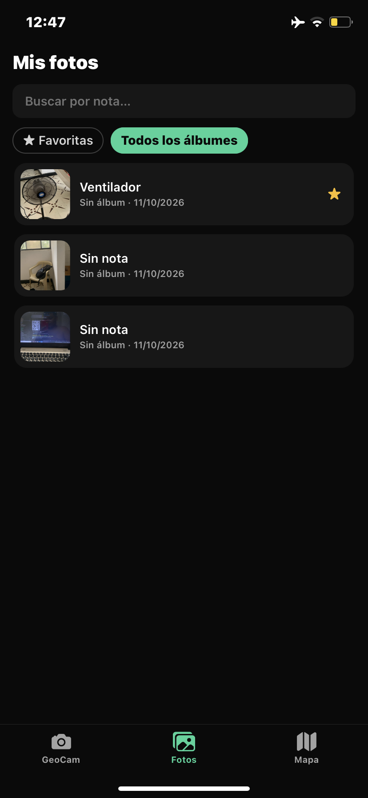

# GeoCam 📸🌎 — Semanas 6 y 7: Sensores + SQLite offline-first

> **Semana 7:** las fotos y sus coordenadas ahora se guardan en **SQLite con Drizzle ORM** y sobreviven al cierre de la app. Ver la sección [Semana 7](#semana-7--geocam-persistente-sqlite--drizzle).

Cámara que etiqueta cada foto con coordenadas GPS, las muestra en un mapa y reacciona al movimiento del teléfono. Todo el hardware está encapsulado en **Custom Hooks tipados** (sin `any`), con permisos pedidos **en contexto** y **limpieza de todas las suscripciones**.

**Integrantes:** Leonardo Hernández, Julián Ortiz
**Curso:** Ecosistema Móvil Moderno — Taller Integrador 2

---

## Stack

| Tecnología | Versión |
|---|---|
| Expo SDK | 57 |
| React Native | 0.86 (New Architecture) |
| Expo Router | `app/(tabs)` con 3 pestañas + ruta `foto/[id]` |
| NativeWind | v4 (Tailwind 3) |
| Módulos nativos | `expo-camera`, `expo-location`, `expo-image-picker`, `expo-sensors`, `react-native-maps` |
| Base local (Semana 7) | `expo-sqlite` + `drizzle-orm` 0.45, migraciones con `drizzle-kit` 0.31, `expo-file-system` (API `File`/`Directory`/`Paths`) |

> Todos los módulos se instalaron con `npx expo install`, no con `npm install`, para usar la versión compatible con el SDK.

## Cómo ejecutar

```bash
npm install
npx expo start          # misma red Wi-Fi que el teléfono
npx expo start --tunnel # si la red bloquea la conexión
```

Escanea el QR con **Expo Go** en un **teléfono físico**: la cámara no funciona en el simulador de iOS.

> **Nota:** la versión de Expo Go del teléfono debe corresponder al SDK del proyecto (campo `expo` en `package.json`).

## Estructura

```
app/
  _layout.tsx            Stack raíz + useMigrations (Semana 7)
  index.tsx              Redirige a /geocam
  (tabs)/
    _layout.tsx          Tabs GeoCam + Fotos + Mapa
    geocam.tsx           Cámara, galería (R2), agitar (R4), nivel, ubicación aproximada
    fotos.tsx            Lista con búsqueda y filtros (C4)
    mapa.tsx             Mapa con markers + lista "Sin ubicación" (R3)
  foto/[id].tsx          Detalle: nota, favorita, álbum, eliminar (C3)
components/
  PermissionPrimer.tsx   Pantalla previa de explicación / "Abrir Ajustes"
  PhotoThumb.tsx         Miniatura con insignia CAM (verde) / GAL (azul)
hooks/
  useGeoLocation.ts      Permiso + lectura única + seguimiento con bandera cancelled
  useCamera.ts           Permiso + captura con guarda isCapturing
  useShake.ts            Acelerómetro: umbral de magnitud + cooldown (R4)
  useLevel.ts            Indicador de nivel (reto opcional)
  usePhotos.ts           useLiveQuery + addPhoto / removePhoto / clearAll (T4, C5)
  usePhoto.ts            Una foto + editar nota / favorita / álbum (C3)
  useAlbums.ts           Listar, crear y borrar álbumes (C1)
  usePhotoSearch.ts      Búsqueda y filtros reactivos (C4)
db/                     (Semana 7)
  schema.ts              Tablas albums y photos + tipos inferidos
  client.ts              openDatabaseSync + enableChangeListener + PRAGMA foreign_keys
  repositories/photos.ts Consultas y CRUD de fotos (única capa con Drizzle)
  repositories/albums.ts CRUD de álbumes (SET NULL en transacción)
drizzle/                 Migraciones 0000 y 0001 generadas con drizzle-kit (versionadas)
services/
  photoFiles.ts          Copiar y borrar fotos en documents/photos (C5)
lib/
  exif.ts                Lectura de coordenadas EXIF iOS/Android (reto opcional)
types/
  geo.ts                 PermissionState, Coords, PhotoSource
```

## Requisitos del taller (Semana 6)

| Req. | Implementación |
|---|---|
| **R1** Estado global | En la Semana 6 era `GeoPhotosContext` con `useReducer`. **En la Semana 7 se reemplazó por SQLite** (`hooks/usePhotos.ts`). |
| **R2** Galería | Botón **GAL**. Usa `launchImageLibraryAsync({ mediaTypes: ['images'] })` y guarda `source: 'gallery'` con las coordenadas actuales o `null`. Estas fotos llevan borde e insignia azules y un marker azul. |
| **R3** Mapa | Un `Marker` por cada foto con coordenadas; al tocarlo aparece una tarjeta con la miniatura. Las fotos sin coordenadas se listan aparte en **"Sin ubicación"**. El mapa se centra en tu ubicación o, sin permiso, en la última foto. |
| **R4** `useShake` | 1. `isAvailableAsync()` → 2. `setUpdateInterval(100)` → 3. umbral sobre √(x²+y²+z²) (1.8 g) → 4. cooldown de 1500 ms → 5. limpieza con bandera `cancelled`. Al agitar aparece un `Alert` que pregunta si se borran todas las fotos. |
| **R5** AI-LOG | Ver [`docs/AI-LOG-semana6.md`](./docs/AI-LOG-semana6.md). |

### Retos opcionales incluidos
- **Nivel**: `useLevel` calcula la inclinación a partir de la gravedad y la línea se pone verde entre ±2°. Los comentarios de `hooks/useLevel.ts` explican por qué no se integró el giroscopio.
- **EXIF de galería**: con `exif: true`, `lib/exif.ts` normaliza el formato de iOS (`{GPS}.Latitude` + `LatitudeRef`) y el de Android (`GPSLatitude` como racional `"11/1,32/1,3840/100"`). Las claves GPS recibidas se imprimen en consola con `[EXIF]`.
- **Ubicación aproximada**: si `accuracy > 1000 m` se muestra un aviso naranja.

## Semana 7 — GeoCam persistente (SQLite + Drizzle)

El `GeoPhotosContext` en memoria de la Semana 6 se reemplazó por **SQLite con Drizzle ORM**. Las fotos, sus coordenadas, notas, favoritas y álbumes sobreviven al cierre de la app, y los archivos de imagen se guardan en la carpeta de documentos.

### Arquitectura por capas

```
Pantallas  app/(tabs)/geocam.tsx · fotos.tsx · mapa.tsx · app/foto/[id].tsx
   ↓ usan
Hooks      usePhotos · usePhoto · useAlbums · usePhotoSearch   (useLiveQuery + acciones)
   ↓ llaman
Repos      db/repositories/photos.ts · albums.ts               (única capa que importa Drizzle)
   ↓                                    services/photoFiles.ts (expo-file-system)
Drizzle    db/schema.ts · db/client.ts
   ↓
expo-sqlite → geocam.db en el dispositivo
```

Las pantallas no importan nada de Drizzle: los tipos `Photo` y `Album` se re-exportan desde los hooks. Solo `app/_layout.tsx` usa `useMigrations`, como indica la guía.

### Diagrama de tablas

```
albums                              photos
┌─────────────────────────────┐     ┌────────────────────────────────┐
│ id          integer PK      │◄─┐  │ id          integer PK         │
│ name        text UNIQUE     │  │  │ uri         text NOT NULL      │
│ created_at  integer (ms)    │  │  │ latitude    real (null)        │
└─────────────────────────────┘  │  │ longitude   real (null)        │
                                 │  │ accuracy    real (null)        │
   1 álbum ─── 0..N fotos        │  │ source      camera | gallery   │
   al borrar el álbum:           │  │ created_at  integer (ms)       │
   album_id = NULL (SET NULL)    └──┤ album_id    integer FK (null)  │ ← C1
                                    │ note        text (null)        │ ← C2
                                    │ favorite    boolean = false    │ ← C2
                                    └────────────────────────────────┘
```

### Migraciones (generadas con `npx drizzle-kit generate`, ninguna editada a mano)

| Archivo | Contenido |
|---|---|
| `drizzle/0000_init_photos.sql` | `CREATE TABLE photos` (taller en clase) |
| `drizzle/0001_albums_note_favorite.sql` | `CREATE TABLE albums` + índice único `name` + `ALTER TABLE photos ADD album_id / note / favorite` |

### Taller en clase (T1–T6)

| Req. | Implementación |
|---|---|
| **T1** | `expo-sqlite`, `drizzle-orm`, `drizzle-kit`, `babel-plugin-inline-import`. `drizzle.config.ts` con `driver: 'expo'`. `babel.config.js` **fusionado** con los presets de NativeWind. `metro.config.js` con `sourceExts.push('sql')` dentro de `withNativeWind`. |
| **T2** | `db/client.ts`: `openDatabaseSync('geocam.db', { enableChangeListener: true })` + `PRAGMA foreign_keys = ON`. `app/_layout.tsx` muestra un loader hasta que `useMigrations` termina. |
| **T3** | `photosRepo`: `listQuery`, `withLocationQuery` (`isNotNull`), `create`, `remove`, `clearAll`. |
| **T4** | `usePhotos`: `photos`, `photosWithLocation`, `addPhoto({ uri, coords, source })` (convierte `coords?.latitude ?? null`), `removePhoto(id)`. |
| **T5** | GeoCam y Mapa usan `usePhotos`. Al agitar se llama a `clearAll` → `photosRepo.clearAll()`. |
| **T6** | ✅ 3 fotos → cerrar Expo Go → reabrir → **3 en el mapa**. |

| Antes de cerrar la app | Después de reabrirla |
|---|---|
|  |  |

### Trabajo para la casa (C1–C6)

| Req. | Implementación | Archivos |
|---|---|---|
| **C1** Álbumes | Tabla `albums` (`name` único). `photos.album_id` con `references(..., { onDelete: 'set null' })`. Crear álbum desde el detalle; mantener presionado el chip para eliminarlo. | `db/schema.ts`, `db/repositories/albums.ts`, `hooks/useAlbums.ts` |
| **C2** Segunda migración | `note` (texto opcional) y `favorite` (`integer` modo `boolean`, por defecto `false`). Probada sobre un iPhone con las 3 fotos de la clase: **siguen ahí**. | `drizzle/0001_albums_note_favorite.sql` |
| **C3** CRUD | `app/foto/[id].tsx`: ver la foto, editar la nota, marcar como favorita, mover de álbum, crear álbum y eliminar con confirmación. | `hooks/usePhoto.ts` |
| **C4** Búsqueda y filtros | Pestaña **Fotos**: buscador por nota (`like`), chips de álbum y **★ Favoritas**, con `useLiveQuery(consulta, [search, albumId, onlyFavorites])`. | `app/(tabs)/fotos.tsx`, `hooks/usePhotoSearch.ts` |
| **C5** Archivos permanentes | Al guardar, la foto se copia de la caché a `documents/photos/` con la API nueva (`File`, `Directory`, `Paths`) y SQLite guarda la ruta nueva. Al eliminar el registro, también se borra el archivo. | `services/photoFiles.ts`, `hooks/usePhotos.ts` |
| **C6** Documentación | Este README + `AI-LOG.md`. | — |

#### Capturas (iPhone, Expo Go SDK 57)

| C2: datos tras la 2.ª migración | C4: lista | C4: filtro ★ Favoritas |
|---|---|---|
|  |  |  |

| C1: foto en álbum "Casa" | C1: álbum borrado, la foto sigue | C5: foto nueva guardada | C3: foto eliminada |
|---|---|---|---|
|  |  |  |  |

### Verificación final
- [x] Dos migraciones generadas con `drizzle-kit generate`, ninguna editada a mano.
- [x] Las fotos de antes de la segunda migración siguen ahí.
- [x] Las pantallas no importan nada de Drizzle: todo pasa por hooks y repositorios.
- [x] Crear, leer, actualizar y borrar funcionan, y los filtros se actualizan solos.
- [x] Las fotos nuevas se guardan en `documents/photos/` y se borran junto con su registro.
- [x] `README.md` y `AI-LOG.md` en la raíz.

### Limitaciones
- Las 3 fotos tomadas en el taller **antes** de C5 conservan su ruta de caché. `deletePhotoFile` solo borra archivos dentro de `documents/photos/`, así que nunca toca la galería ni la caché del sistema.

## Máquina de estados de permisos

```
checking → undetermined → (acepta) → granted
                        → (rechaza) → denied → (rechaza de nuevo) → blocked
blocked → Linking.openSettings() → (lo activa en Ajustes) → granted
```

Al volver de Ajustes, ambos hooks **re-consultan** el permiso mediante `AppState` sin volver a pedirlo, así que la pantalla pasa sola de *blocked* a *granted*.

## Capturas (iPhone, Expo Go SDK 57)

| Permisos concedidos + R4 agitar | R3 Mapa (foto de cámara) | R2 Galería |
|---|---|---|
|  |  |  |

- **Concedido:** cámara activa, coordenadas en vivo (±17 m en Riohacha) e indicador de nivel (13°).
- **R4:** al agitar en la pestaña GeoCam aparece "¿Borrar todas las fotos? Se eliminarán 2 foto(s)". Al confirmar, el mapa queda vacío.
- **R3:** marcador **verde** = cámara y **azul** = galería. La tarjeta muestra la miniatura, las coordenadas, la fecha y el botón Eliminar.
- **Rechazado / Bloqueado:** sin ubicación aparece un banner ámbar y la cámara sigue funcionando. Con el permiso bloqueado se muestra el botón **"Abrir Ajustes"** (`components/PermissionPrimer.tsx`). En iOS el permiso queda bloqueado tras el primer rechazo.

### Log de limpieza del GPS
Al cambiar entre las pestañas GeoCam y Mapa, la terminal muestra:
```
LOG  [useGeoLocation] GPS iniciado
LOG  [useGeoLocation] cleanup: GPS detenido
```

## Verificación en el teléfono

- [x] **Niega la ubicación** → la cámara sigue funcionando, aparece el banner ámbar y la foto queda en "Sin ubicación".
- [x] **Niega la cámara dos veces en Android** → aparece "Abrir Ajustes" (estado `blocked`).
- [x] **Sal de la pestaña GeoCam** → en la terminal debe aparecer `[useGeoLocation] cleanup: GPS detenido`.
- [x] La app **no pide permisos al abrirse**: solo al tocar "Permitir acceso" o el banner.
- [x] Agita el teléfono con fotos → aparece el `Alert` una sola vez.

### Detalle importante: las pestañas no se desmontan
Expo Router **mantiene montadas** las pestañas al cambiar de tab. Por eso el `cleanup` de un `useEffect` **no** se ejecutaría solo con salir de la pestaña. La solución fue usar `useIsFocused()`:
- `useGeoLocation({ watch: isFocused })` → el efecto de seguimiento se limpia al perder el foco.
- `useShake(..., { enabled: isFocused })` y `useLevel(isFocused)` → el acelerómetro se libera.
- `<CameraView active={isFocused} />` → el preview de la cámara se pausa.

## Limitaciones conocidas
- En **Expo Go** los textos de permisos de `app.json` no se ven; aparecen los genéricos de Expo Go. Solo se ven en un build propio.
- En **Android 10+** el sistema puede quitar la ubicación del EXIF de las fotos de galería, así que en esos casos se usa la ubicación actual.
- En producción Android, `react-native-maps` requiere una API key de Google Maps.