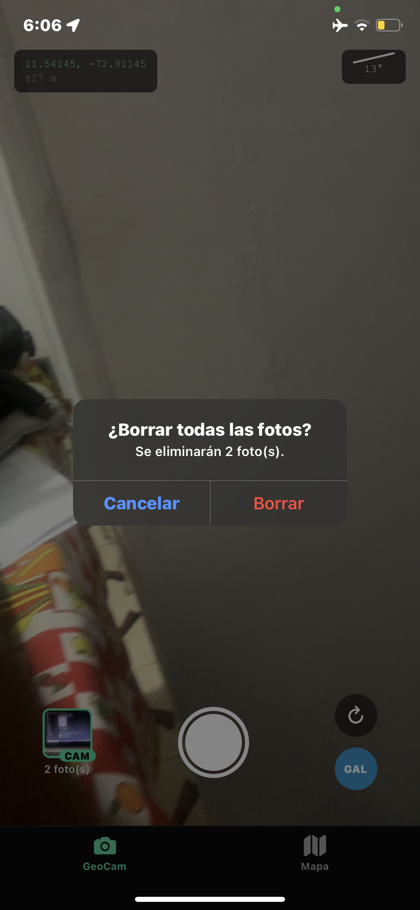
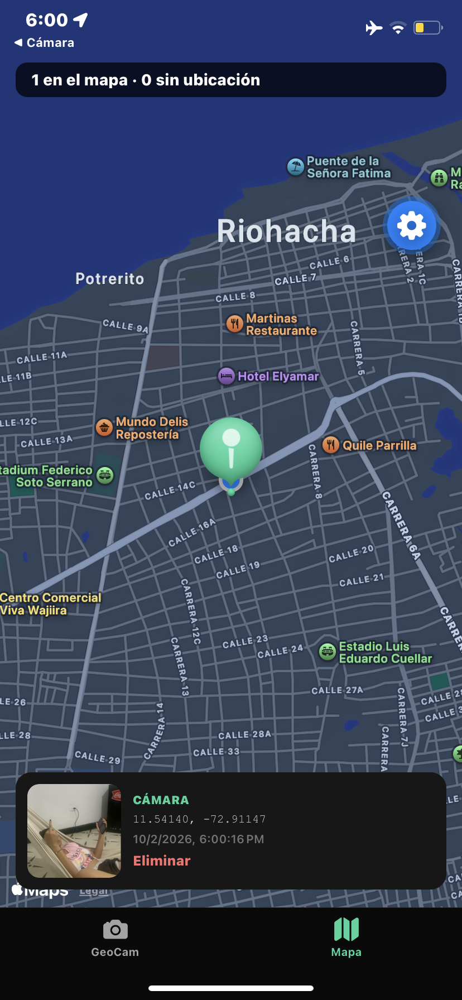
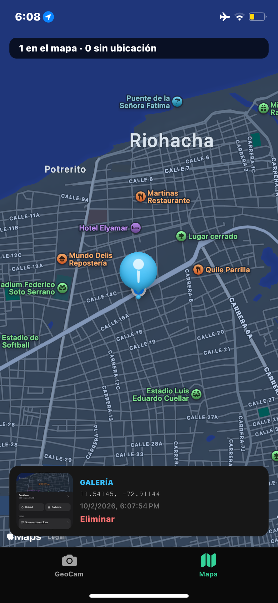

# GeoCam 📸🌎 — Semana 6: Módulos Nativos y Sensores

Cámara que etiqueta cada foto con coordenadas GPS, las muestra en un mapa y reacciona al movimiento del teléfono. Todo el hardware está encapsulado en **Custom Hooks tipados** (sin `any`), con permisos pedidos **en contexto** y **limpieza de todas las suscripciones**.

**Integrantes:** Leonardo Hernández, Julián Ortiz
**Curso:** Ecosistema Móvil Moderno — Taller Integrador 2

---

## Stack

| Tecnología | Versión |
|---|---|
| Expo SDK | 57 |
| React Native | 0.86 (New Architecture) |
| Expo Router | `app/(tabs)` con 2 pestañas |
| NativeWind | v4 (Tailwind 3) |
| Módulos nativos | `expo-camera`, `expo-location`, `expo-image-picker`, `expo-sensors`, `react-native-maps` |

> Todos los módulos se instalaron con `npx expo install`, no con `npm install`, para usar la versión compatible con el SDK.

## Cómo ejecutar

```bash
npm install
npx expo start          # misma red Wi-Fi que el teléfono
npx expo start --tunnel # si la red bloquea la conexión
```

Escanea el QR con **Expo Go** en un **teléfono físico**: la cámara no funciona en el simulador de iOS.

> **Nota:** la versión de Expo Go del teléfono debe corresponder al SDK del proyecto (campo `expo` en `package.json`).

## Estructura

```
app/
  _layout.tsx            Stack raíz + global.css
  index.tsx              Redirige a /geocam
  (tabs)/
    _layout.tsx          Tabs + GeoPhotosProvider (R1)
    geocam.tsx           Cámara, galería (R2), agitar (R4), nivel, ubicación aproximada
    mapa.tsx             Mapa con markers + lista "Sin ubicación" (R3)
components/
  PermissionPrimer.tsx   Pantalla previa de explicación / "Abrir Ajustes"
  PhotoThumb.tsx         Miniatura con insignia CAM (verde) / GAL (azul)
hooks/
  useGeoLocation.ts      Permiso + lectura única + seguimiento con bandera cancelled
  useCamera.ts           Permiso + captura con guarda isCapturing
  useShake.ts            Acelerómetro: umbral de magnitud + cooldown (R4)
  useLevel.ts            Indicador de nivel (reto opcional)
context/
  GeoPhotosContext.tsx   addPhoto / removePhoto / clearAll con useReducer inmutable (R1)
lib/
  exif.ts                Lectura de coordenadas EXIF iOS/Android (reto opcional)
types/
  geo.ts                 PermissionState, Coords, GeoPhoto
```

## Requisitos del taller

| Req. | Implementación |
|---|---|
| **R1** Estado global | `GeoPhotosContext` con `useReducer`. Las operaciones son inmutables: `[photo, ...state]`, `filter` y `[]`. El Provider está en `app/(tabs)/_layout.tsx`. |
| **R2** Galería | Botón **GAL**. Usa `launchImageLibraryAsync({ mediaTypes: ['images'] })` y guarda `source: 'gallery'` con las coordenadas actuales o `null`. Estas fotos llevan borde e insignia azules y un marker azul. |
| **R3** Mapa | Un `Marker` por cada foto con coordenadas; al tocarlo aparece una tarjeta con la miniatura. Las fotos sin coordenadas se listan aparte en **"Sin ubicación"**. El mapa se centra en tu ubicación o, sin permiso, en la última foto. |
| **R4** `useShake` | 1. `isAvailableAsync()` → 2. `setUpdateInterval(100)` → 3. umbral sobre √(x²+y²+z²) (1.8 g) → 4. cooldown de 1500 ms → 5. limpieza con bandera `cancelled`. Al agitar aparece un `Alert` que pregunta si se borran todas las fotos. |
| **R5** AI-LOG | Ver [`AI-LOG.md`](./AI-LOG.md). |

### Retos opcionales incluidos
- **Nivel**: `useLevel` calcula la inclinación a partir de la gravedad y la línea se pone verde entre ±2°. Los comentarios de `hooks/useLevel.ts` explican por qué no se integró el giroscopio.
- **EXIF de galería**: con `exif: true`, `lib/exif.ts` normaliza el formato de iOS (`{GPS}.Latitude` + `LatitudeRef`) y el de Android (`GPSLatitude` como racional `"11/1,32/1,3840/100"`). Las claves GPS recibidas se imprimen en consola con `[EXIF]`.
- **Ubicación aproximada**: si `accuracy > 1000 m` se muestra un aviso naranja.

## Máquina de estados de permisos

```
checking → undetermined → (acepta) → granted
                        → (rechaza) → denied → (rechaza de nuevo) → blocked
blocked → Linking.openSettings() → (lo activa en Ajustes) → granted
```

Al volver de Ajustes, ambos hooks **re-consultan** el permiso mediante `AppState` sin volver a pedirlo, así que la pantalla pasa sola de *blocked* a *granted*.

## Capturas (iPhone, Expo Go SDK 57)

| Permisos concedidos + R4 agitar | R3 Mapa (foto de cámara) | R2 Galería |
|---|---|---|
|  |  |  |

- **Concedido:** cámara activa, coordenadas en vivo (±17 m en Riohacha) e indicador de nivel (13°).
- **R4:** al agitar en la pestaña GeoCam aparece "¿Borrar todas las fotos? Se eliminarán 2 foto(s)". Al confirmar, el mapa queda vacío.
- **R3:** marcador **verde** = cámara y **azul** = galería. La tarjeta muestra la miniatura, las coordenadas, la fecha y el botón Eliminar.
- **Rechazado / Bloqueado:** sin ubicación aparece un banner ámbar y la cámara sigue funcionando. Con el permiso bloqueado se muestra el botón **"Abrir Ajustes"** (`components/PermissionPrimer.tsx`). En iOS el permiso queda bloqueado tras el primer rechazo.

### Log de limpieza del GPS
Al cambiar entre las pestañas GeoCam y Mapa, la terminal muestra:
```
LOG  [useGeoLocation] GPS iniciado
LOG  [useGeoLocation] cleanup: GPS detenido
```

## Verificación en el teléfono

- [x] **Niega la ubicación** → la cámara sigue funcionando, aparece el banner ámbar y la foto queda en "Sin ubicación".
- [x] **Niega la cámara dos veces en Android** → aparece "Abrir Ajustes" (estado `blocked`).
- [x] **Sal de la pestaña GeoCam** → en la terminal debe aparecer `[useGeoLocation] cleanup: GPS detenido`.
- [x] La app **no pide permisos al abrirse**: solo al tocar "Permitir acceso" o el banner.
- [x] Agita el teléfono con fotos → aparece el `Alert` una sola vez.

### Detalle importante: las pestañas no se desmontan
Expo Router **mantiene montadas** las pestañas al cambiar de tab. Por eso el `cleanup` de un `useEffect` **no** se ejecutaría solo con salir de la pestaña. La solución fue usar `useIsFocused()`:
- `useGeoLocation({ watch: isFocused })` → el efecto de seguimiento se limpia al perder el foco.
- `useShake(..., { enabled: isFocused })` y `useLevel(isFocused)` → el acelerómetro se libera.
- `<CameraView active={isFocused} />` → el preview de la cámara se pausa.

## Limitaciones conocidas
- En **Expo Go** los textos de permisos de `app.json` no se ven; aparecen los genéricos de Expo Go. Solo se ven en un build propio.
- Escribir coordenadas en el EXIF del JPG requiere librerías nativas fuera de Expo Go. Por eso las fotos se guardan como objetos `GeoPhoto` en memoria, que serán el esquema de SQLite en la Semana 7.
- En **Android 10+** el sistema puede quitar la ubicación del EXIF de las fotos de galería, así que en esos casos se usa la ubicación actual.
- En producción Android, `react-native-maps` requiere una API key de Google Maps.
